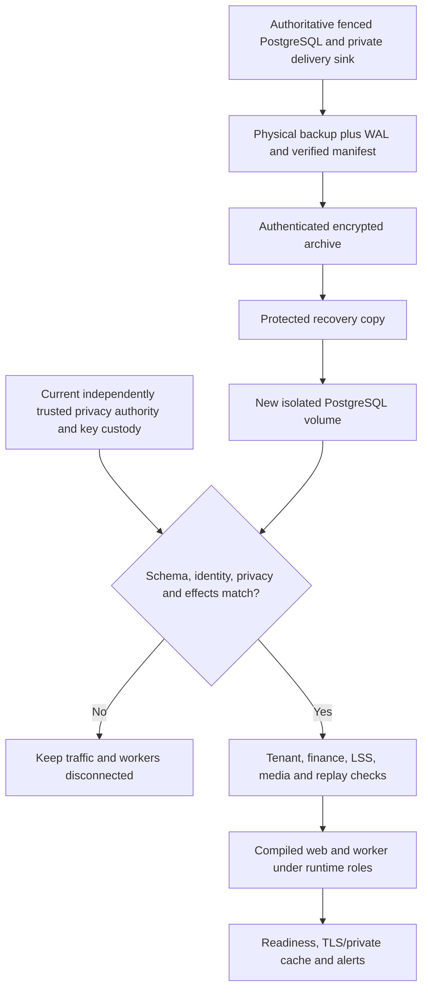

# ADR-0015: staged release artifacts and erasure-aware physical recovery

Date: 2026-10-07 (Africa/Kampala). Status: accepted for isolated staging; production decisions remain open.

## Context

R2 left schema 018 and the local G4 accepted with external conditions. P12 needs executable release/recovery evidence without treating development adapters, a logical copy or a same-host archive as a production disaster-recovery service. A backup taken before a completed erasure must not silently restore erased information. Authentication keys and external delivery receipts also affect whether restored data can be used safely.

## Decision

Build a digest-pinned Node 24 image with standalone web, independent worker, monitor and a separately invoked migrator. Keep normal app processes non-root/read-only with explicit resources, stop deadlines and separate credentials. PostgreSQL remains the canonical store for media bytes, originals, variants and tenant-scoped references. Retain application authorization and immutable database history guards. A shared non-owner DML role supports web/worker; an aggregate-only view supports monitoring. These grants are not RLS or compromise containment.

Run physical `pg_basebackup` with streamed WAL and SHA-256 manifest verification in an owned isolated cluster. Fence all writers and archive the local notification sink at the same checkpoint. Seal the archive with authenticated AES-256-GCM and a separately escrowed 32-byte key. Authentication, wrong-key/corruption rejection and no-overwrite publication precede archive availability. The rehearsal's second local encrypted file is explicitly not an independent failure domain.

Before admitting a restored cluster, require a fresh separately trusted signed authority binding cluster identity, database, migration checksums and current privacy state. Recheck completed erasure effects. Never derive the admission authority from an old restore to approve itself. The current algorithm rejects a stale backup; it does not merge exclusions or rewrite immutable history. Loss of the current authority source blocks admission until an approved independent exclusion process can establish correctness. Production needs independently durable exclusion journaling and key custody, retention and RPO/RTO approval.

Rebuild only derived indexes/projections. Replay supported pending jobs with original identities and durable delivery receipts; reconcile any post-checkpoint financial activity against independent sources. Rehearse compatible application rollback and forward fix against the same schema and unchanged financial history. Keep paid AI and optional destructive effects off. Application rollback is not database rollback.

Use a small closed transport grammar for AI structured output after Gemini rejected the deeper canonical JSON schema. All required nullable fields, accepted operations and types are explicit. Provider decoder cardinality/string/reference constraints are applied again by the strict local wire parser and original canonical intent/LSS validators. No foreign references, arbitrary code/tools, automatic publishing or relaxed local limits are introduced. Gemini's real bounded contract passed; OpenAI returned `401 invalid_api_key` and remains unverified.

## Flow

## Consequences

The local drill provides concrete physical-recovery evidence for T25 and reviewable artifacts/runbooks. It does not approve production RPO/RTO, independently hosted backups, real domain/CDN/mail/collection integration, legal policy, real-device accessibility or production launch. The loopback adapter guard remains. See the [runbook](../RELEASE-RUNBOOK.md) and [P12 dossier](../evidence/P12.md) for conditions and measured results.
