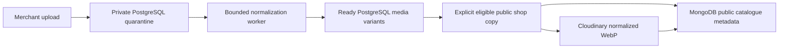

# Cloudinary public images and MongoDB catalogue linkage

Cloudinary is the image provider. MongoDB holds **metadata**, not image bytes. PostgreSQL remains authoritative for shop eligibility, product/asset ownership, accounts, tenancy/rent, durable jobs, audit and private media. The implemented provider path is a manually refreshed **public copy**; it is not a MongoDB migration or automatic storage replacement.



## What is uploaded

An explicit `services -- copy SHOP_UUID --confirm-public-copy` reads a coherent PostgreSQL snapshot of eligible published shops. Only managed images attached to non-archived public products in non-archived departments, in state `ready`, with a creator and a normalized display blob, are candidates. Composite shop/merchant foreign keys and scoped joins prevent foreign product/asset links.

The adapter accepts a normalized single-frame WebP of at most **2 MiB**, width/height at most **1920**. It sends a signed multipart request to the fixed Cloudinary image-upload HTTPS endpoint, with redirects denied, bounded timeout/response and `overwrite=false`. Originals, quarantined files, private evidence, identity documents, guest requests, finance and audit data never enter this path. The main application still serves its existing scoped media routes from PostgreSQL; it does not render an untrusted MongoDB document.

## Locate and retrieve a copy

Each image has these durable identifiers:

| Field | Meaning |
| --- | --- |
| `assetId` | Immutable PostgreSQL asset UUID; shop/merchant ownership stays in PostgreSQL. |
| `digest` | SHA-256 of the normalized bytes, so changed content has a different identifier. |
| `publicId` | `londos-public-copy/ASSET_UUID/SHA256`, searchable in the Cloudinary Media Library/API. |
| `url` | Checked HTTPS Cloudinary delivery URL for that exact public ID and WebP format. No key or secret appears in it. |
| `width`, `height` | Validated normalized dimensions. |

MongoDB stores one document per shop UUID in **`londos_public_copies`**, in the explicitly selected database. `products[].imageAssetId` joins to `images[].assetId`; `products[].imageAlt` carries merchant-supplied alternative text. A product without an eligible image has null linkage. Catalogue fields are allowlisted and price minor units remain exact strings. Each shop document has a generation UUID and copy timestamp.

To retrieve an image, an authorized integration first checks current PostgreSQL public eligibility, then resolves the product's asset ID in the copied `images` list and uses its checked public HTTPS delivery URL. To locate the provider record for maintenance, search the exact `publicId` in the correct Cloudinary cloud. Use the provider's authenticated console/server API for maintenance; never expose its API secret to a browser. The delivery URL is public, so do not put private content behind it.

The adapter checks the response public ID, byte count, dimensions, format and delivery hostname/path. A response pointing at a different image in the same cloud is rejected. Credentials are parsed with generic errors; provider error bodies are not logged. Repeating a copy replaces one MongoDB shop document rather than duplicating it. Content-addressed image IDs avoid overwriting a different image's content.

## Manual operation and failure behavior

Configure `CLOUDINARY_URL` privately and set `LONDOS_CLOUDINARY_ENABLED=true`. Configure `MONGODB_URL` (or legacy `MONGODB_URI`), its dedicated database and `LONDOS_MONGODB_ENABLED=true`. Keep migration false. MongoDB connection/CRUD verification does not require Cloudinary; a public copy with images does.

```bash
npm run mongo:verify
npm run services -- check
npm run services -- copy SHOP_UUID --confirm-public-copy
npm run services -- read SHOP_UUID
```

The check performs read-only Cloudinary usage access. Unit/integration transports can mock provider responses without an outbound upload; a mock success does not establish a real Cloudinary account/quota/CDN result. Missing/invalid enabled configuration appears in the recent-MFA operations status page. Main PostgreSQL/local workflows continue with optional services disabled.

Batch bounds are 1–20 explicit shops, at most 50 departments, 1,000 products and 100 eligible assets per shop. Uploads happen outside the PostgreSQL snapshot transaction, followed by a current public eligibility/published-design check. Each MongoDB document replacement is atomic; the entire batch is not. A failed batch can leave previously completed shop documents and orphan public images. No private application state is migrated or automatically failed over.

## Retention and deployment limits

External snapshots can become stale after a product edit, shop suspension or asset deletion. The Londos `read` helper rejects shops that are no longer eligible, but direct provider/CDN access cannot enforce PostgreSQL authorization. Do not make this collection an unrestricted private application API. Existing downloaded content cannot be recalled.

Before live public-copy use, approve a copy retention/removal procedure, including Cloudinary/CDN invalidation and interrupted-batch orphan cleanup. Locate exact asset public IDs using the metadata; remove only reviewed obsolete objects through provider tools and reconcile copied catalogue references. There is currently no automatic external deletion/purge service or production privacy completion claim. Private evidence stays in the protected canonical storage/recovery contract.

For Render and local installation, use [Render setup](RENDER-SETUP.md) and [local first setup](LOCAL-FIRST-SETUP.md). Both require PostgreSQL for this implementation. A MongoDB-only host cannot run the existing auth, accounting and job architecture.
