# Londos system and journey illustrations

These diagrams describe the intended application and the implemented preview separately. The SVG artwork under `public/illustrations` is platform-owned fictional demonstration art; it is not merchant-uploaded content or photography.

## Intended application boundaries

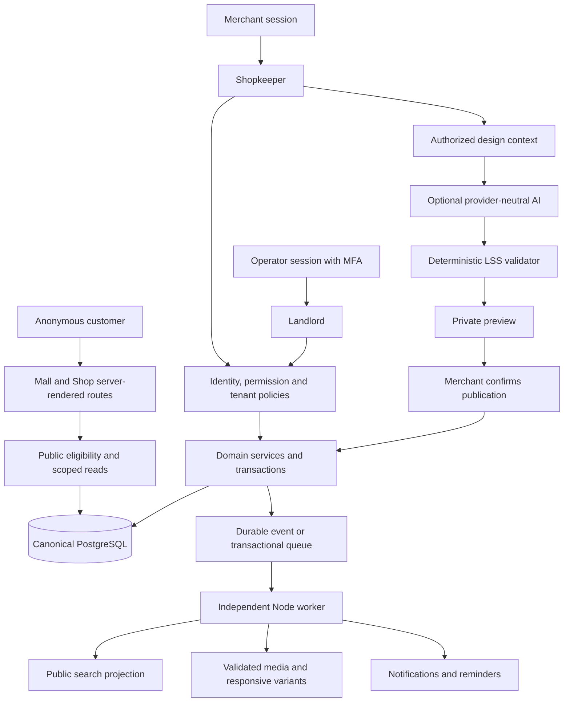

X1 implements local PostgreSQL, the initial session/MFA/permission boundary and the durable worker. X2 adds catalogue/contact commands, guest requests and private worker media processing. P6/P7 adds safe LSS/publication, canonical PostgreSQL search and eligible public image delivery. P8 adds local applications/review, development rent/provisioning, scheduled tenancy, owner teams/addresses and scoped shop operations. P9 adds local reporting/moderation/appeals, truthful development verification, assigned incidents/owner-confirmed recovery and privacy-minimized analytics. P9 adds governed local privacy/cost reporting; P10 adds the private deterministic/provider-contract assistant and P11 completes the bounded semantic registry. Live providers and production operational integrations remain separate gates. The complete diagram is the intended system, not a claim that every component is ready.

## Implemented X1 identity and mutation boundary

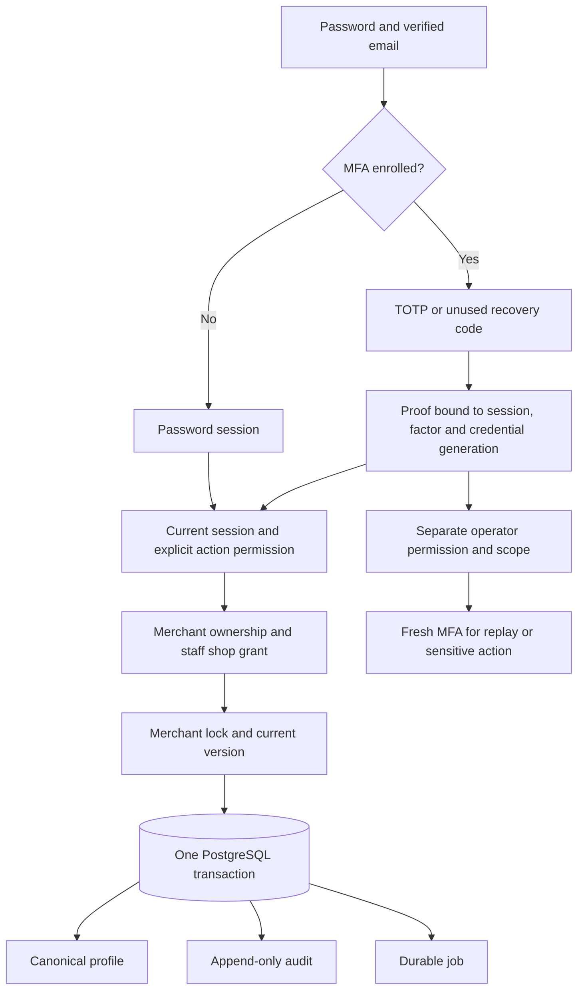

Private page policy also runs before HTML/Flight streaming. Domain/handler authorization remains required. Customers continue browsing without authentication.

## R1 credential and invitation revocation

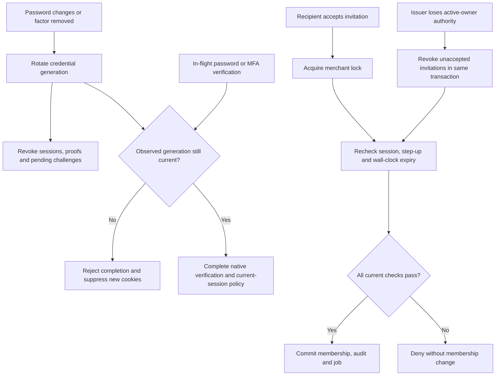

Migration 007 invalidates old MFA proofs while preserving users and sessions. [R1 evidence](evidence/R1-REVIEW.md) records actual factor/reset races, lock-wait expiry/logout tests and database preservation. Ordinary operations already authorized at their final check are not promised retroactive cancellation.

## Implemented X1 job recovery

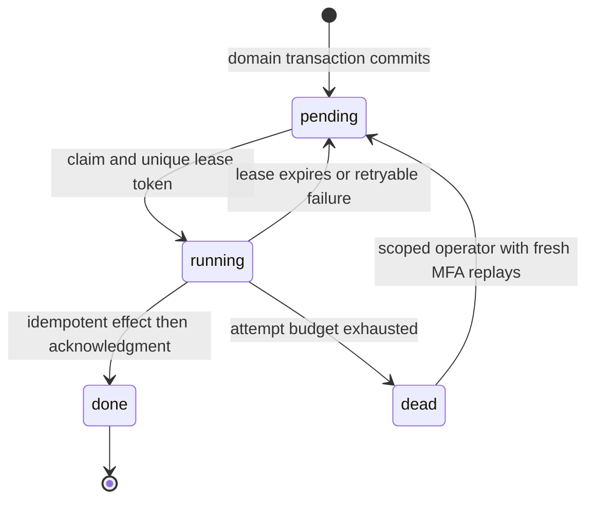

The separate worker reads canonical versions, fences old leases and uses a durable effect receipt. Local notifications use an atomic private file keyed by job ID. Forced process-death tests cover commit, effect and delivery boundaries; real provider delivery still requires its own idempotency evidence.

## Initial canonical relationships

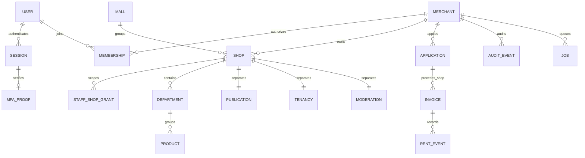

Composite database keys additionally enforce tenant/shop agreement; the diagram omits those columns for readability. Future feature schemas and command transitions evolve through new reviewed migrations.

## Implemented anonymous preview journey

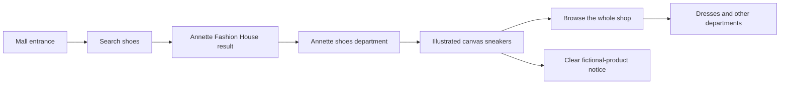

No account or AI call is needed for this path. Purchases and enquiries remain unavailable in the read-only preview.

## Model handoff sequence

```mermaid
flowchart LR
  H[Sol 6.1 High foundation] --> Reminder[Save evidence and remind owner]
  Reminder --> Confirm[Owner confirms Extra High setting]
  Confirm --> X1[Sol 6.1 Extra High security and persistence]
  X1 --> Astra[Owner switches to 6 Astra Extra High review]
  Astra --> R1[Save R1 findings, fixes and evidence]
  R1 --> Switch[Owner confirms Sol 6.1 Extra High]
  Switch --> X2[X2 catalogue, contact and media]
  X2 --> P6[P6 safe manual design and publication]
  P6 --> P7[P7 eligible public discovery and benchmark]
  P7 --> P8[P8 local applications and development rent]
  P8 --> Admin[P8 local teams, addresses and scoped operations]
  Admin --> Trust[P9 local reporting, moderation and independent appeals]
  Trust --> Next[Remaining P9 governed privacy and costs before later gates and Astra R2]
```

The assistant records the next setting in BUILD-STATUS. The owner operates the model selector; the assistant does not switch it automatically.

## Local artwork inventory

- `mall.svg`: independent shops around a shared courtyard.
- `shop-*.svg`: six category-specific sample storefronts.
- `product-*.svg`: ten product/service illustrations, marked as samples.

The application renders these fixed trusted SVGs with explicit dimensions and lazy loading except for initial hero/product art. Tenant SVG uploads are rejected by the implemented X2 media policy; only bounded single-frame JPEG, PNG and WebP are accepted.

Validated screenshots and their exact stage/environment are recorded in [the High-stage evidence report](evidence/HIGH-STAGE.md).

The [X1 evidence report](evidence/X1-STAGE.md#visual-evidence) records inspected desktop shop-profile and mobile account-security screenshots from the local production build. All pictured identities and shops are fictional; no authentication secrets are pictured.

## Implemented X2 private-media path

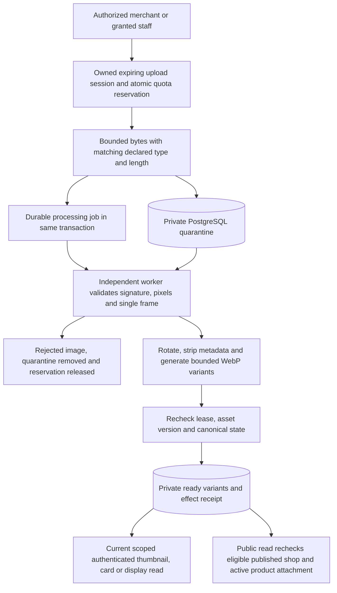

Raw quarantine and the normalized rebuild source have no public or workspace download route. A pending replacement leaves the product's prior ready image attached. Referenced assets cannot be deleted; expiry cleanup and tombstones prevent delayed jobs from resurrecting deleted media.

## Implemented X2 guest-request path

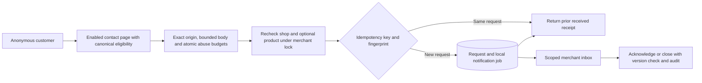

A received or acknowledged request does not confirm an order, payment or stock reservation. Private customer details stay in the scoped inbox; notification payloads contain identifiers only. Live retention and delivery policies remain owner decisions.

The [X2 evidence report](evidence/X2-P5.md) includes inspected production-browser screenshots of the [catalogue and inbox](evidence/images/x2-catalogue-desktop.png) and [anonymous contact page](evidence/images/x2-guest-contact.png). They contain fictional/sample data, without authentication secrets.

## Implemented X2 design and public eligibility

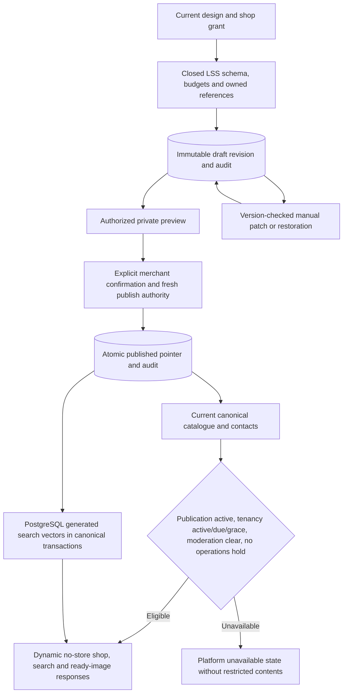

Restoring a layout never restores an old price/contact/payment setting. The renderer uses a read-only snapshot and current canonical resources; request-local memoization avoids duplicate metadata/page reads without a shared response cache. Future remote browser/CDN revocation and live financial/provider policies require separate evidence.

Inspected X2 prototype captures: [merchant design](evidence/images/x2-design-desktop.png), [public product with a synthetic ready image](evidence/images/x2-public-product.png) and [mobile search on the isolated 1,500-shop dataset](evidence/images/x2-architecture-search.png). See [the complete experiment and limits](evidence/X2-P6-P7.md).

## Implemented P8 development lifecycle

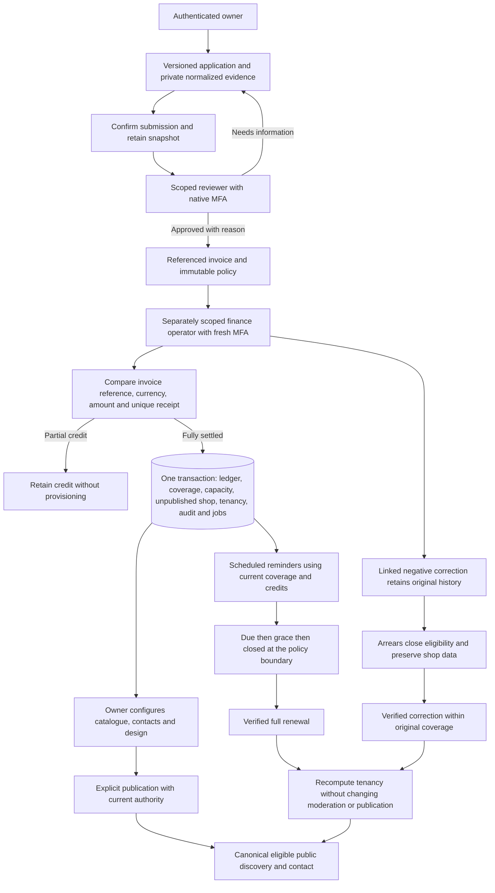

This is a development workflow: **UGX 5,000 per 30 days, seven days’ grace and manual operator reconciliation; live collection disabled**. Stable command keys, append-only financial events and merchant locks prevent duplicate credit/provisioning. An old job cannot carry an authoritative payment date. Only new P8 contracts enter the scheduler; previous fixtures remain unchanged. See [ADR-0006](ADR/0006-local-applications-and-rent-lifecycle.md) and [P8 verification/screenshots](evidence/X2-P8.md).

## Implemented P8 team and address continuity

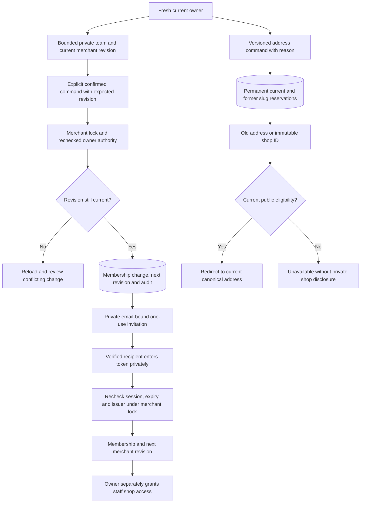

Last-owner protection and issuer-invitation revocation remain active. A token is not a URL, and membership alone does not give staff shop access. The address registry is append-only; direct SQL cannot transfer an old address to another shop.

## Implemented P8 scoped operations and independent holds

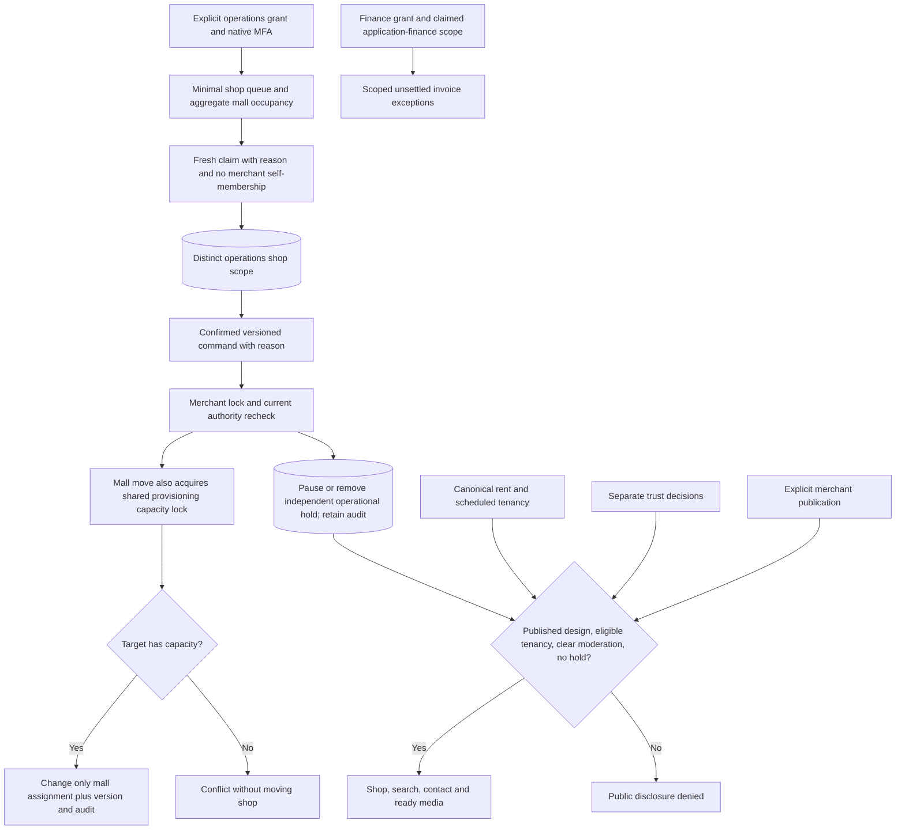

Resume removes only the hold. It cannot credit an invoice, renew rent, publish a draft or clear moderation. Capacity moves preserve identity, address, ownership, catalogue and financial history. [Administration evidence](evidence/X2-P8-ADMIN.md) records races, scoped HTTP/Flight denial, upgrade preservation and inspected [desktop team](evidence/images/x2-p8-team-desktop.png), [desktop operations](evidence/images/x2-p8-operations-desktop.png) and [mobile team](evidence/images/x2-p8-team-mobile.png) captures. All pictured data is fictional.

## Implemented P9 private reporting and review

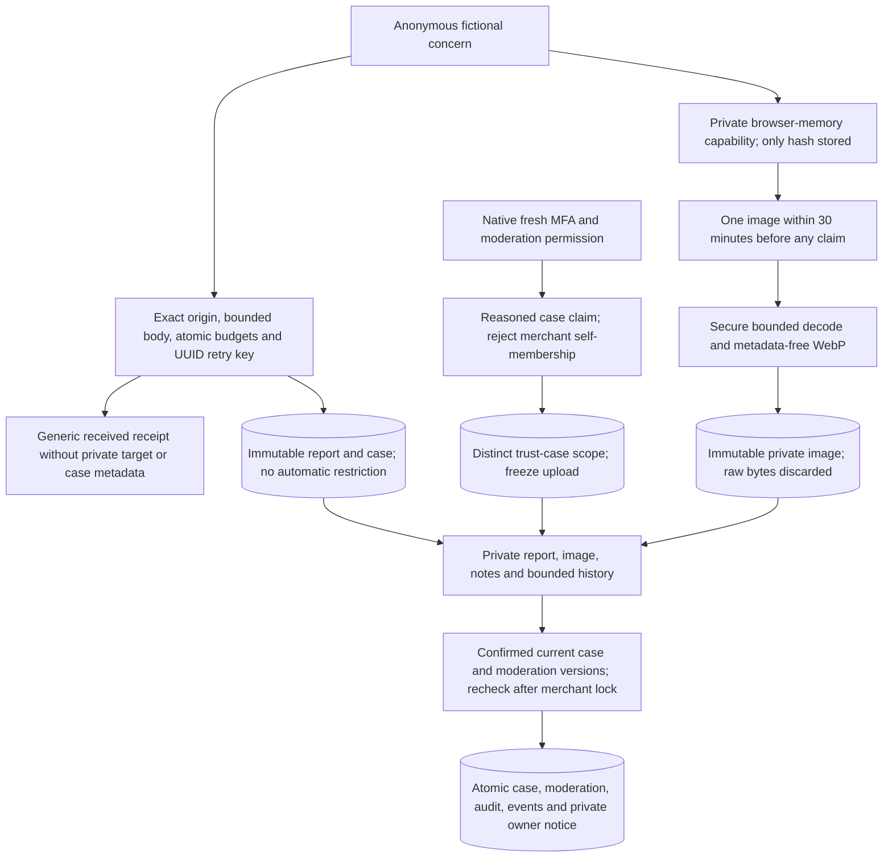

Report/capability text never enters public rendering or local notice payloads. Finance/support/operations grants and scopes do not substitute for a trust case. Public badge state is derived separately from approved P8 application review and disclosed only as a fictional development review.

## Implemented P9 appeals and independent eligibility

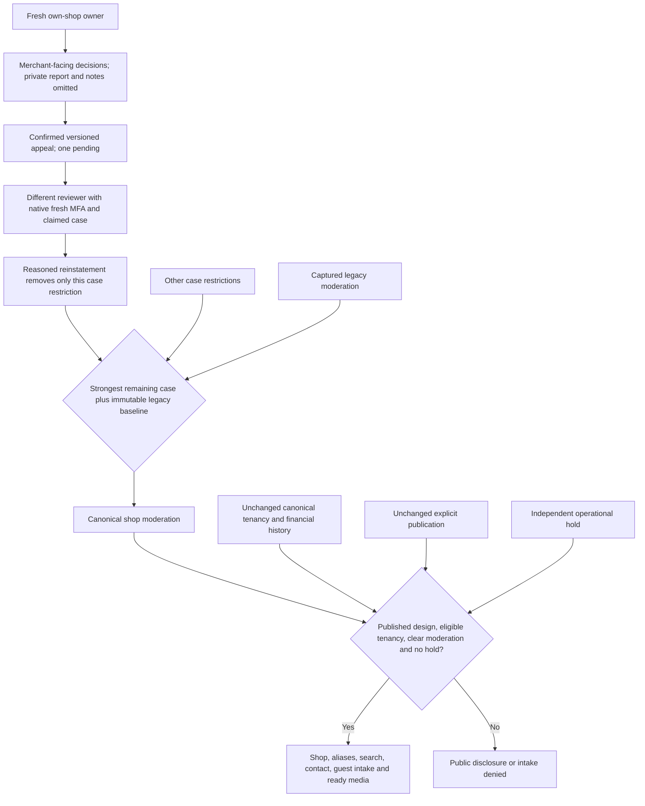

External moderation conflicts fail closed; clearing one case cannot clear another or a captured legacy restriction. [P9 evidence](evidence/X2-P9.md) records inspected [desktop report](evidence/images/x2-p9-report-desktop.png), [private review](evidence/images/x2-p9-review-desktop.png) and [mobile report](evidence/images/x2-p9-report-mobile.png) captures. All pictured content is fictional; no authentication secrets are pictured.

## Implemented P9 accountable incident queues

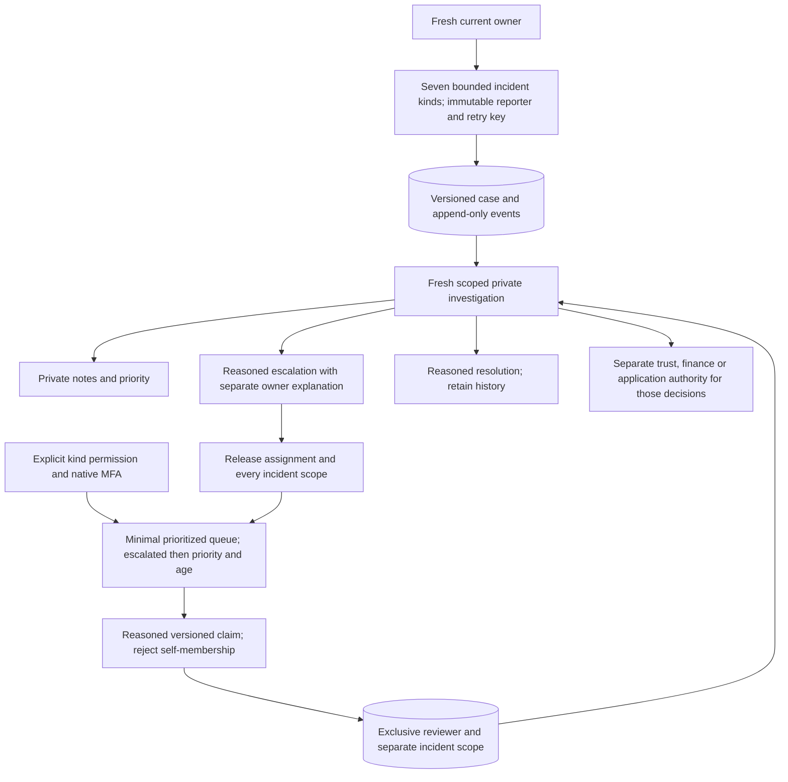

Kind grants do not confer other workflow scopes. Ordinary support cannot contain accounts or restore sensitive contacts. Escalation supports qualified reassignment; live response targets and staff ownership remain a policy gate.

## Implemented P9 original-owner confirmed restoration

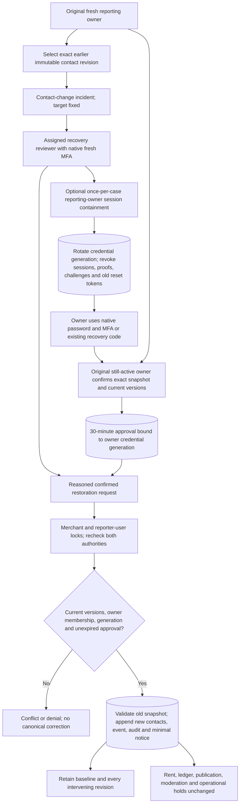

Captured history starts at the current upgrade baseline. Containment/password changes invalidate confirmation; later contact edits require renewed confirmation. There is no lost-all-factor/email/ownership adjudication bypass or direct operator contact update.

[Incident evidence](evidence/X2-P9-INCIDENTS.md) records the inspected [assigned reviewer](evidence/images/x2-p9-incident-review-desktop.png), [redacted owner history](evidence/images/x2-p9-incident-owner-desktop.png) and [mobile keyboard-focused form](evidence/images/x2-p9-incident-mobile.png). All pictured data is fictional; no authentication secrets are pictured.

## Implemented P9 minimal pilot observations

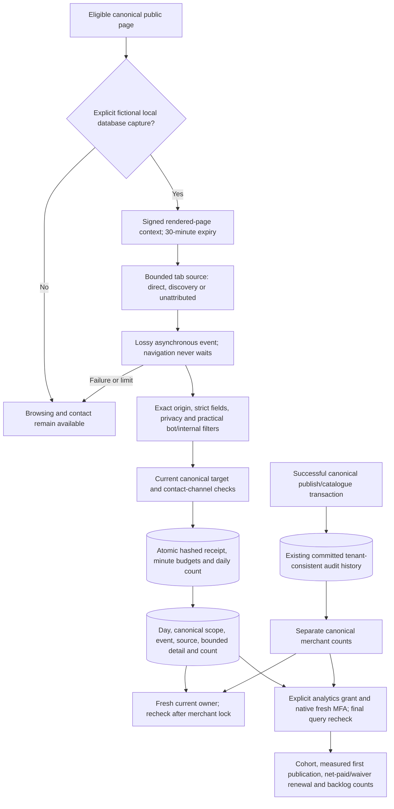

No visitor identity, raw query/IP/referrer or private evidence enters metrics. Receipt identity belongs to a rendered context, not a person. Blocked storage remains unattributed; contact intent is not a completed sale. Analytics storage never participates in canonical merchant transactions. Operators receive aggregate summaries without private case/ledger viewers or decision authority.

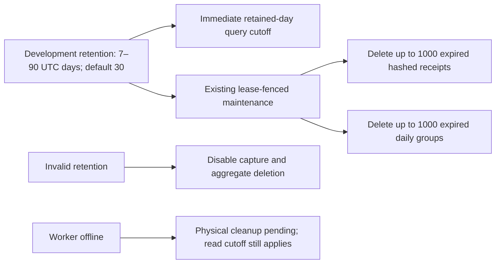

This cleanup governs minimal analytics tables only. Broader evidence/enquiry/incident/legal/backups export/deletion and measurable costs remain later P9 work. [Analytics evidence](evidence/X2-P9-ANALYTICS.md) records inspected [owner desktop](evidence/images/x2-p9-analytics-owner-desktop.png), [analytics-only operator desktop](evidence/images/x2-p9-analytics-operator-desktop.png) and [mobile window/keyboard focus](evidence/images/x2-p9-analytics-mobile.png). All pictured data is fictional; live analytics is disabled.

## Implemented local privacy governance

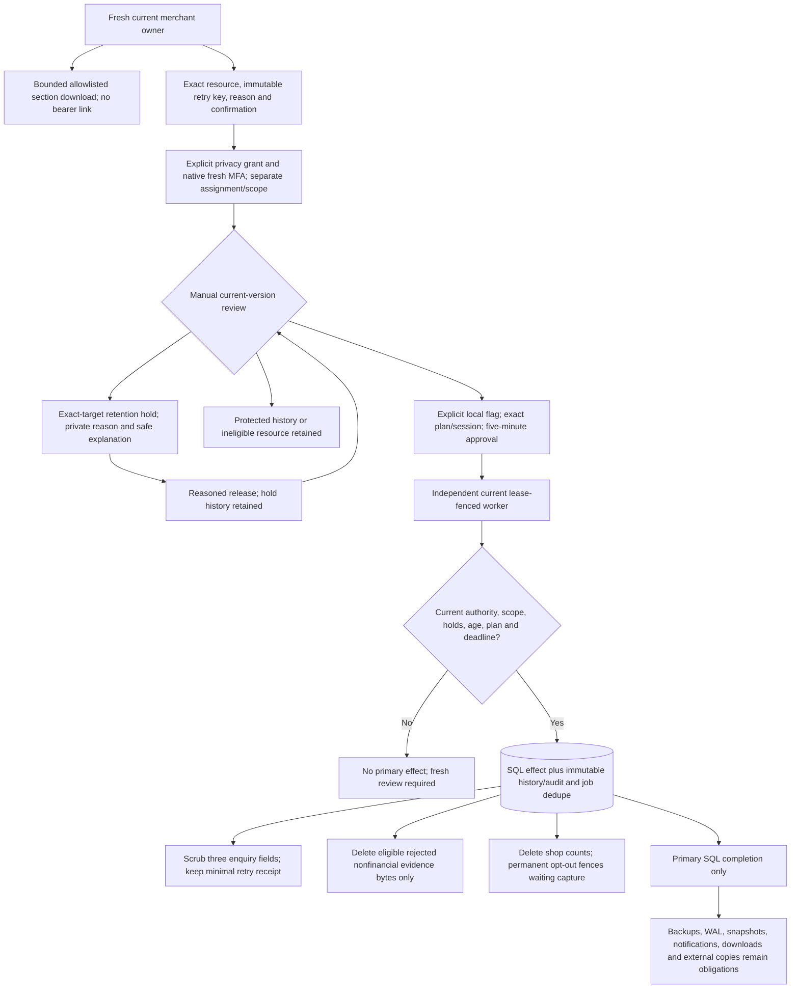

Erasure is default-off fictional loopback functionality. Financial/account/trust/incident/contact/audit history remains retained, and arrears closure never deletes data. Holds survive cancelled/denied/unassigned requests. These diagrams do not establish live legal erasure or physical backup handling. See [privacy evidence](evidence/X2-P9-PRIVACY.md) and the inspected fictional [owner desktop](evidence/images/x2-p9-privacy-owner-desktop.png), [scoped reviewer desktop](evidence/images/x2-p9-privacy-review-desktop.png) and [mobile accessible cancellation](evidence/images/x2-p9-privacy-mobile.png) captures.


## P9 measured resources and reported operating costs

[ADR-0012](ADR/0012-local-resource-cost-reporting.md) and [cost evidence](evidence/X2-P9-COSTS.md) distinguish current logical snapshots, manual reporting and missing measurements. No path creates a merchant charge or changes existing jobs.

```mermaid
flowchart TD
  Blobs[Canonical managed SQL blob lengths] --> Snapshot[Current logical media and queue snapshots]
  Quota[Recorded quota and reserved headroom] --> Snapshot
  Jobs[Tenant-consistent current job state and counters] --> Snapshot
  Snapshot --> Owner[Fresh current owner: safe own-shop aggregates]
  Snapshot --> Platform[Explicit costs grant and native fresh MFA]
  Shared[Separate platform and merchant shared jobs] --> Platform
  Evidence[Coarse application and trust evidence volume] --> Platform
  Platform --> Claim[Reasoned current-version shop scope claim]
  Claim --> Journal[Private shop journal: native grant and scope rechecks]
  Journal --> Original[Reported integer minutes and UGX expenses]
  Original --> Correction[One exact linked negative correction]
  Original --> Totals[Net totals by original UTC work day]
  Correction --> Totals
  Totals --> Owner
  Missing[Unavailable bandwidth, AI, prices and independent staff time] --> Disclosure[Unknown actual costs and reporting coverage]
  Disclosure --> Owner
  Disclosure --> Platform
```

Shared jobs and pre-shop evidence are not allocated by invented estimates. Reserved bytes are headroom; missing quota is unavailable. Authorized replay can reset current attempt counters. Manual amounts keep minutes/money separate, with no hourly rate or provider-billing claim. Immutable original/correction history and UTC windows preserve interpretation.

The following fictional captures were inspected for readable labels, limits, private-owner redaction and bounded layout; native tests cover keyboard/accessibility and overflow. Operator journal reasons are private fictional fixture text, without credentials or real personal information.

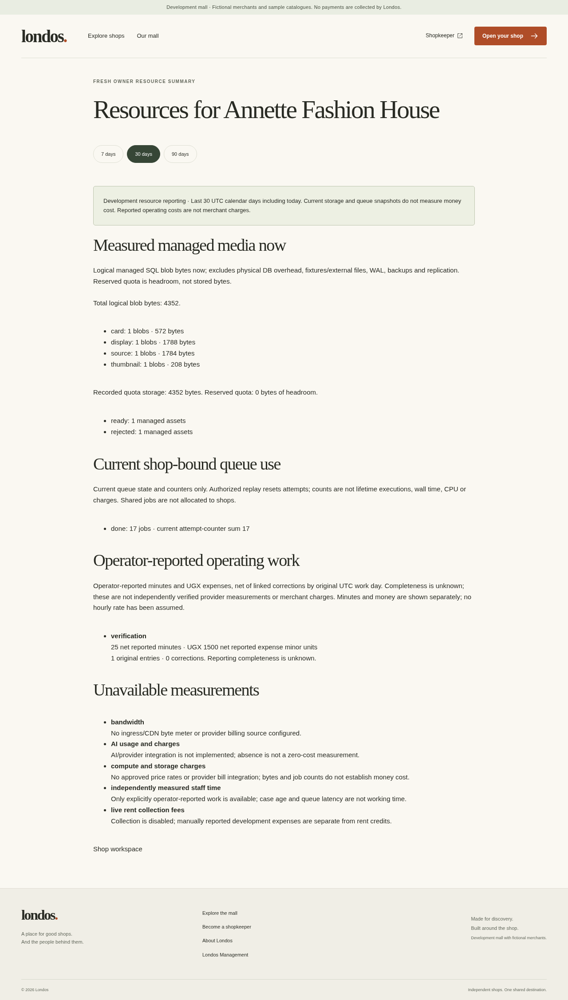

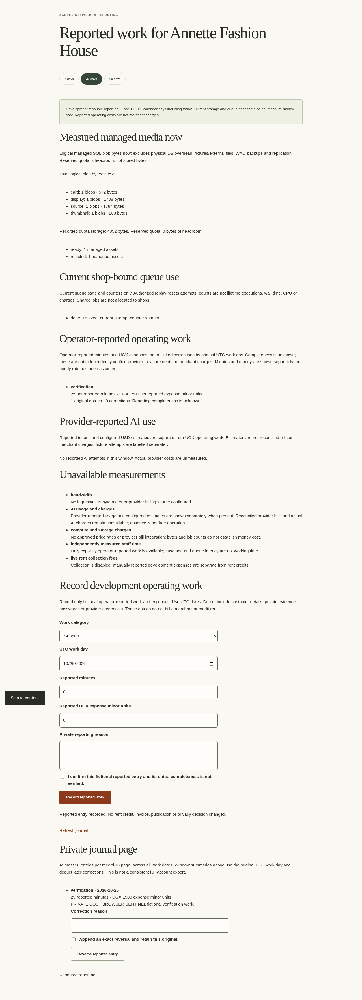

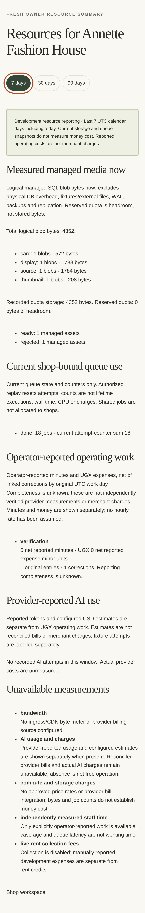

## P10 native proposal workflow

| Illustration | Source and meaning |
|---|---|
| [Desktop assistant](evidence/images/x2-p10-assistant-desktop.png) | Production-build native owner workflow in a disposable fictional database; validated deterministic blue-theme proposal, no provider calls, separate preview/confirmation. |
| [Canonical candidate preview](evidence/images/x2-p10-proposal-preview.png) | Unsaved private candidate rendered by the existing canonical LSS renderer; no draft/publication/analytics effects, with explicit return to review. |
| [Mobile assistant](evidence/images/x2-p10-assistant-mobile.png) | Native keyboard-triggered deterministic contact-action proposal, labelled confirmation, unavailable live providers and separate reported-usage explanations; no overflow/axe violations in the recorded viewport. |

These three captures were visually inspected. They are fictional local workflow evidence, not live Gemini/OpenAI demonstrations or manual screen-reader certification. Prior packet illustrations remain preserved. [P10 evidence](evidence/X2-P10.md) records security/verification/preservation limits; the [design pipeline](SHOP-DESIGN-PIPELINE.md) diagrams the implemented boundary.

## P11 semantic shops, continuation and measured load

| Illustration | Recorded meaning |
|---|---|
| [Desktop catalogue](evidence/images/x2-p11-catalogue-core-desktop.png) / [mobile catalogue](evidence/images/x2-p11-catalogue-core-mobile.png) | Production native 20-row department continuation with 46 fictional items and a next-page link. Most fixture items intentionally have no photo. |
| [Earth](evidence/images/x2-p11-template-earth.png), [plum](evidence/images/x2-p11-template-plum.png), [blue](evidence/images/x2-p11-template-blue.png) | All eight new/old compatible semantic spaces on a 390×844 emulated mobile device; photograph/filters/gallery/service desk resolve canonical data. Repeated coffee images are the attributed CC0 fixture, not merchant products. |
| [Bounded shop-first search](evidence/images/x2-p11-search.png) | Twenty eligible shop results and continuation from the generated scale dataset. |
| [Load and saturation plot](evidence/images/x2-p11-load.png) | Final actual p50/p95/p99/throughput at 1/5/20/40 clients; 40 is a diagnostic overload phase. |

All six captures and the plot were visually inspected for readable labels, bounded layout/navigation and factual captions. Native tests verify keyboard/labels/axe/overflow; the experiment validates three rendered templates under reduced motion, 4× CPU slowdown and 150 ms/1.6 Mbps emulation. These captures do not certify actual handset/Ugandan-network or screen-reader user sessions. Photo attribution is retained in [fixture provenance](../tests/fixtures/README.md); [P11 evidence](evidence/X2-P11.md) records the final gate and limits. Historical illustrations remain unchanged.

```mermaid
flowchart LR
  Forms[Native semantic forms or private AI proposal] --> Validate[Strict shared LSS and current owned references]
  Validate --> Preview[Private canonical preview]
  Preview --> Confirm[Confirmed draft]
  Confirm --> Publish[Separate fresh publication]
  Publish --> Read[Two independent web processes]
  Read --> SQL[(Canonical eligibility and bounded PostgreSQL reads)]
  Mutation[Catalogue transaction] --> Counter[Per-shop generation increment]
  Counter --> SQL
  SQL --> Cursor[20 rows and scoped continuation]
  Cursor --> Restart[Explicit restart after catalogue change]
```
