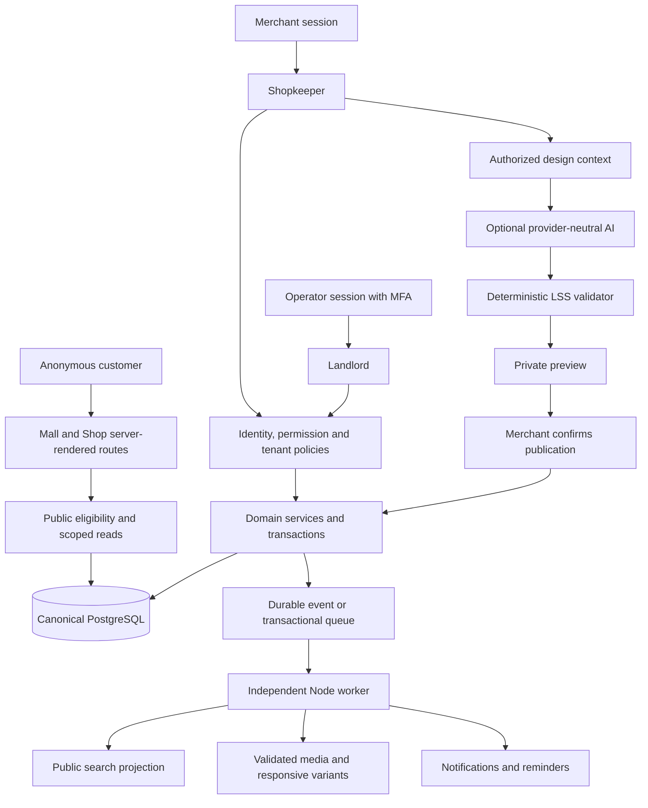
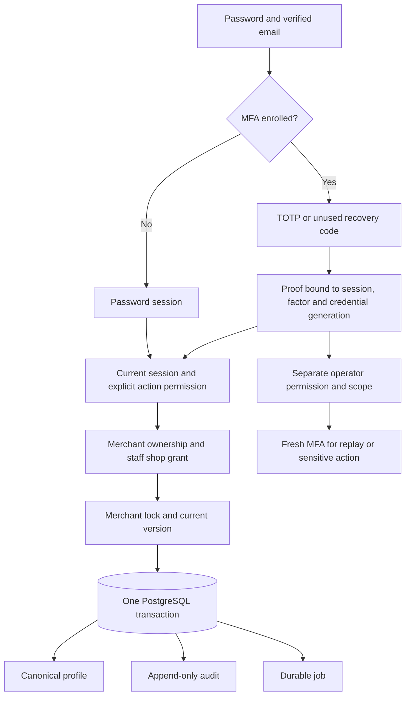
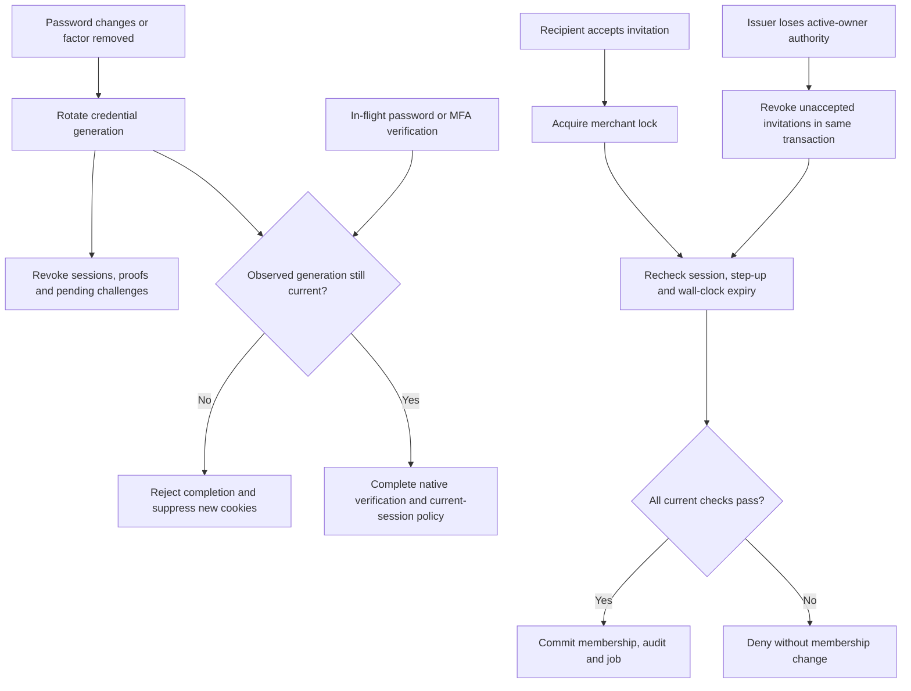
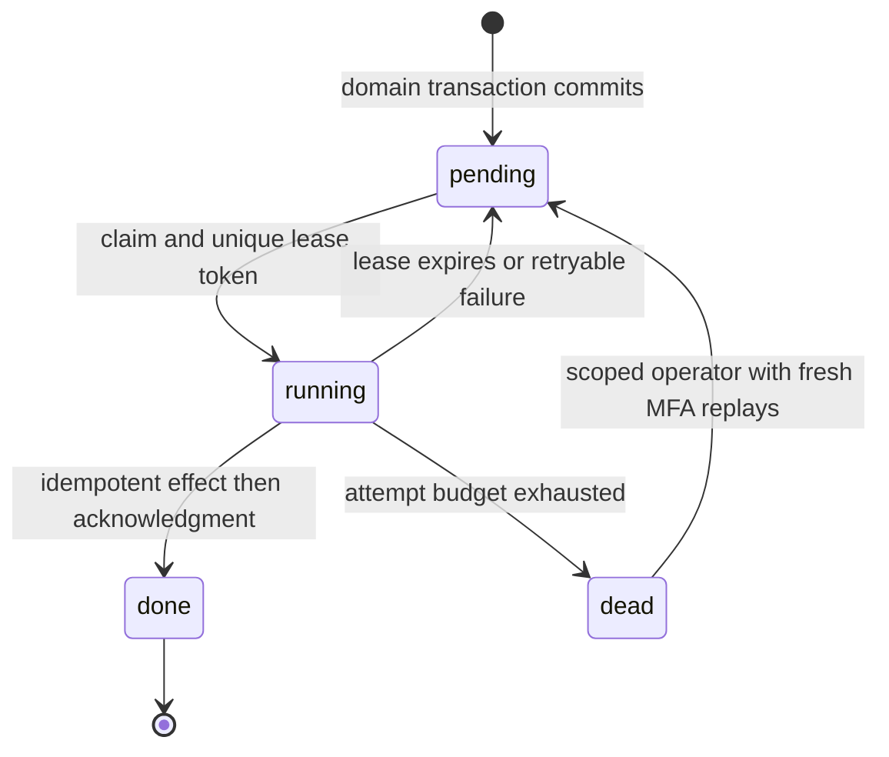
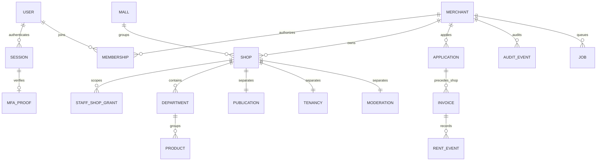
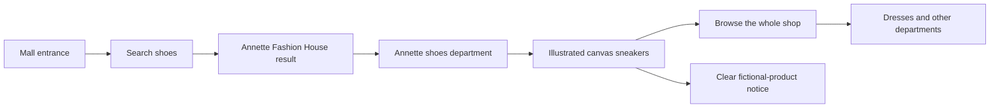
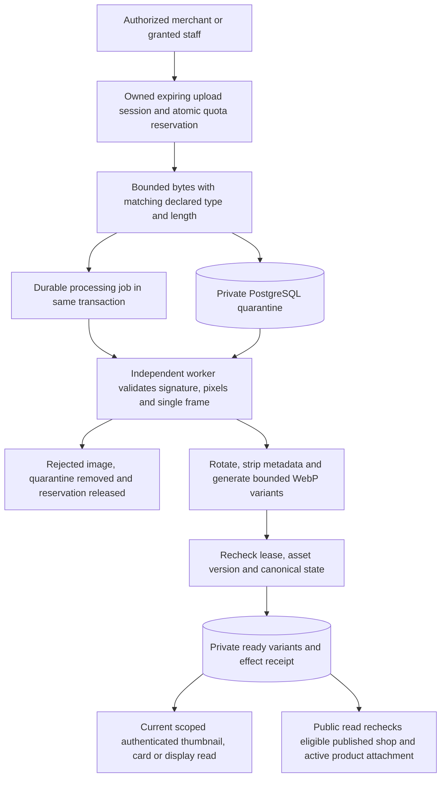
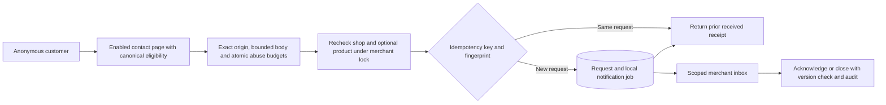
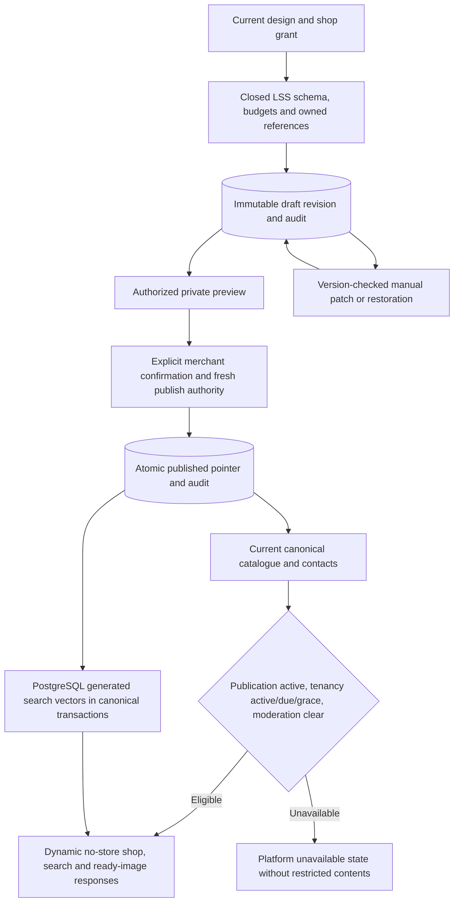

# Londos system and journey illustrations

These diagrams describe the intended application and the implemented preview separately. The SVG artwork under `public/illustrations` is platform-owned fictional demonstration art; it is not merchant-uploaded content or photography.

## Intended application boundaries

X1 implements local PostgreSQL, the initial session/MFA/permission boundary and the durable worker. X2 adds catalogue/contact commands, guest requests and private worker media processing. The P6/P7 prototype adds safe LSS/publication, canonical PostgreSQL search and eligible public image delivery. Rent, live providers, the wider renderer registry and AI remain later stages. The complete diagram is the intended system, not a claim that every component is ready.

## Implemented X1 identity and mutation boundary

Private page policy also runs before HTML/Flight streaming. Domain/handler authorization remains required. Customers continue browsing without authentication.

## R1 credential and invitation revocation

Migration 007 invalidates old MFA proofs while preserving users and sessions. [R1 evidence](evidence/R1-REVIEW.md) records actual factor/reset races, lock-wait expiry/logout tests and database preservation. Ordinary operations already authorized at their final check are not promised retroactive cancellation.

## Implemented X1 job recovery

The separate worker reads canonical versions, fences old leases and uses a durable effect receipt. Local notifications use an atomic private file keyed by job ID. Forced process-death tests cover commit, effect and delivery boundaries; real provider delivery still requires its own idempotency evidence.

## Initial canonical relationships

Composite database keys additionally enforce tenant/shop agreement; the diagram omits those columns for readability. Future feature schemas and command transitions evolve through new reviewed migrations.

## Implemented anonymous preview journey

No account or AI call is needed for this path. Purchases and enquiries remain unavailable in the read-only preview.

## Model handoff sequence

```mermaid
flowchart LR
  H[Sol 6.1 High foundation] --> Reminder[Save evidence and remind owner]
  Reminder --> Confirm[Owner confirms Extra High setting]
  Confirm --> X1[Sol 6.1 Extra High security and persistence]
  X1 --> Astra[Owner switches to 6 Astra Extra High review]
  Astra --> R1[Save R1 findings, fixes and evidence]
  R1 --> Switch[Owner confirms Sol 6.1 Extra High]
  Switch --> X2[X2 catalogue, contact and media]
  X2 --> P6[P6 safe manual design and publication]
  P6 --> P7[P7 eligible public discovery and benchmark]
  P7 --> Next[Continue plan gates and later Astra R2 review]
```

The assistant records the next setting in BUILD-STATUS. The owner operates the model selector; the assistant does not switch it automatically.

## Local artwork inventory

- `mall.svg`: independent shops around a shared courtyard.
- `shop-*.svg`: six category-specific sample storefronts.
- `product-*.svg`: ten product/service illustrations, marked as samples.

The application renders these fixed trusted SVGs with explicit dimensions and lazy loading except for initial hero/product art. Tenant SVG uploads are rejected by the implemented X2 media policy; only bounded single-frame JPEG, PNG and WebP are accepted.

Validated screenshots and their exact stage/environment are recorded in [the High-stage evidence report](evidence/HIGH-STAGE.md).

The [X1 evidence report](evidence/X1-STAGE.md#visual-evidence) records inspected desktop shop-profile and mobile account-security screenshots from the local production build. All pictured identities and shops are fictional; no authentication secrets are pictured.

## Implemented X2 private-media path

Raw quarantine and the normalized rebuild source have no public or workspace download route. A pending replacement leaves the product's prior ready image attached. Referenced assets cannot be deleted; expiry cleanup and tombstones prevent delayed jobs from resurrecting deleted media.

## Implemented X2 guest-request path

A received or acknowledged request does not confirm an order, payment or stock reservation. Private customer details stay in the scoped inbox; notification payloads contain identifiers only. Live retention and delivery policies remain owner decisions.

The [X2 evidence report](evidence/X2-P5.md) includes inspected production-browser screenshots of the [catalogue and inbox](evidence/images/x2-catalogue-desktop.png) and [anonymous contact page](evidence/images/x2-guest-contact.png). They contain fictional/sample data, without authentication secrets.

## Implemented X2 design and public eligibility

Restoring a layout never restores an old price/contact/payment setting. The renderer uses a read-only snapshot and current canonical resources; request-local memoization avoids duplicate metadata/page reads without a shared response cache. Future remote browser/CDN revocation and live financial/provider policies require separate evidence.

Inspected X2 prototype captures: [merchant design](evidence/images/x2-design-desktop.png), [public product with a synthetic ready image](evidence/images/x2-public-product.png) and [mobile search on the isolated 1,500-shop dataset](evidence/images/x2-architecture-search.png). See [the complete experiment and limits](evidence/X2-P6-P7.md).
