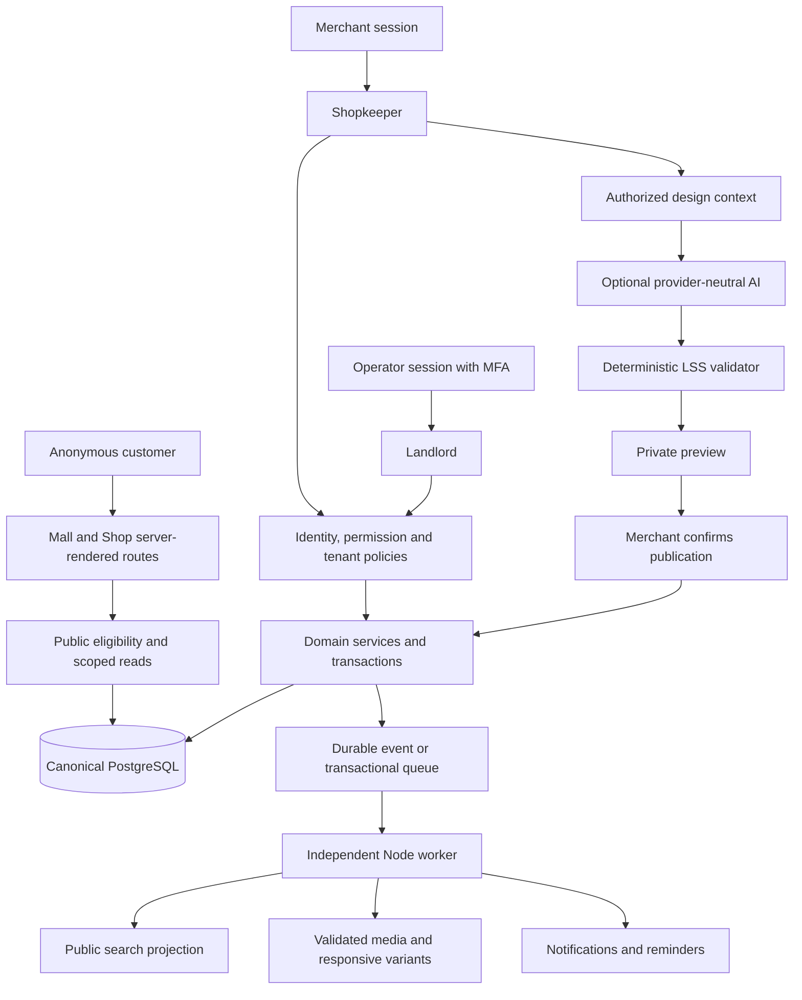
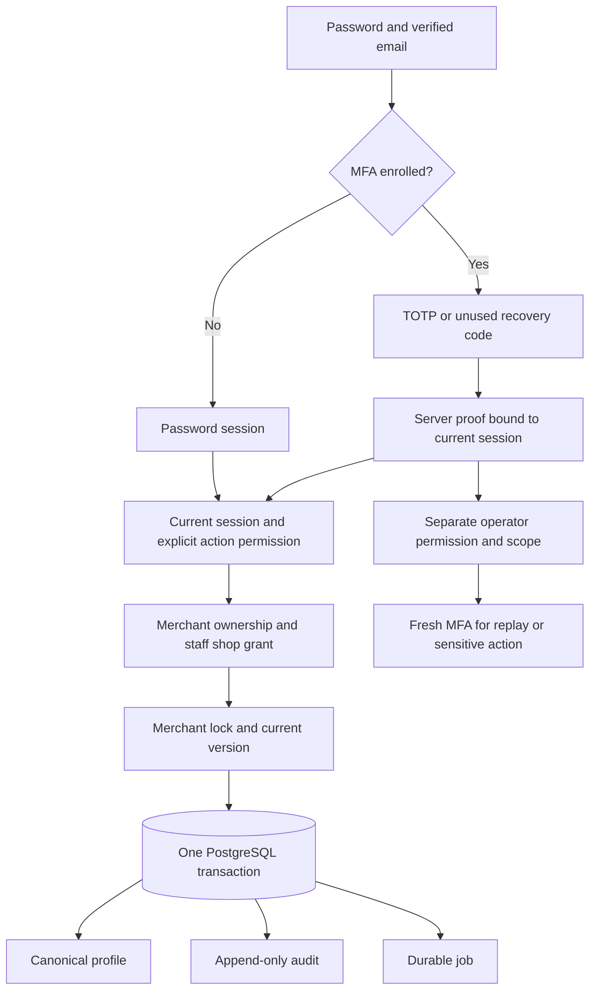
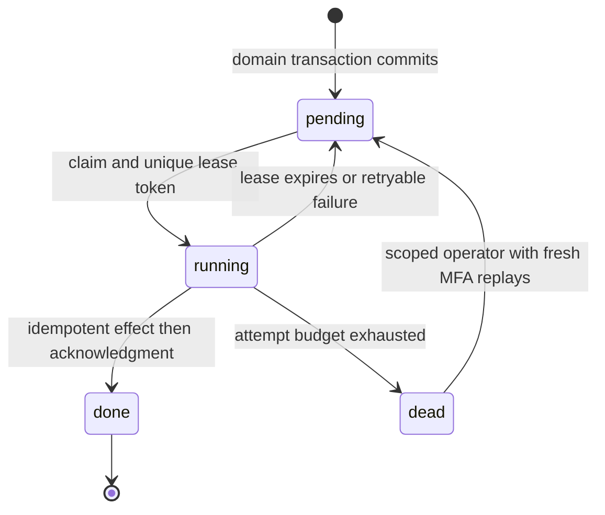
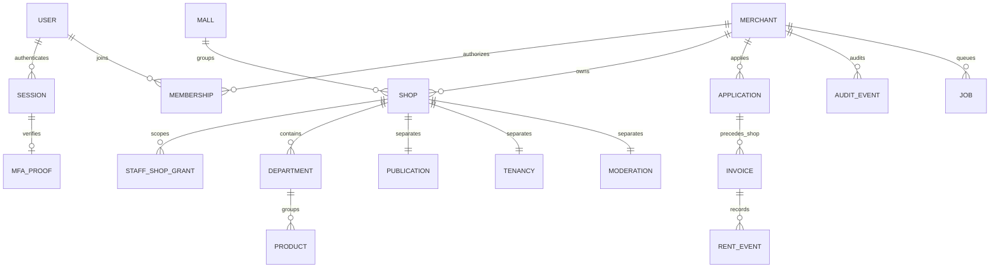
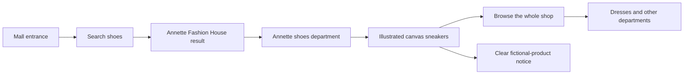
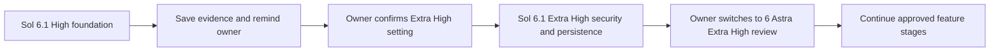

# Londos system and journey illustrations

These diagrams describe the intended application and the implemented preview separately. The SVG artwork under `public/illustrations` is platform-owned fictional demonstration art; it is not merchant-uploaded content or photography.

## Intended application boundaries

X1 implements local PostgreSQL, the initial session/MFA/permission boundary and the durable worker. Public PostgreSQL eligibility/search, media processing, rent workflows, LSS publication and AI remain later stages. The complete diagram is the intended system, not a claim that every component is ready.

## Implemented X1 identity and mutation boundary

Private page policy also runs before HTML/Flight streaming. Domain/handler authorization remains required. Customers continue browsing without authentication.

## Implemented X1 job recovery

The separate worker reads canonical versions, fences old leases and uses a durable effect receipt. Local notifications use an atomic private file keyed by job ID. Forced process-death tests cover commit, effect and delivery boundaries; real provider delivery still requires its own idempotency evidence.

## Initial canonical relationships

Composite database keys additionally enforce tenant/shop agreement; the diagram omits those columns for readability. Future feature schemas and command transitions evolve through new reviewed migrations.

## Implemented anonymous preview journey

No account or AI call is needed for this path. Purchases and enquiries remain unavailable in the read-only preview.

## Model handoff sequence

The assistant records the next setting in BUILD-STATUS. The owner operates the model selector; the assistant does not switch it automatically.

## Local artwork inventory

- `mall.svg`: independent shops around a shared courtyard.
- `shop-*.svg`: six category-specific sample storefronts.
- `product-*.svg`: ten product/service illustrations, marked as samples.

The application renders these fixed trusted SVGs with explicit dimensions and lazy loading except for initial hero/product art. Arbitrary tenant SVG uploads are not enabled; their validation policy belongs to the media-security stage.

Validated screenshots and their exact stage/environment are recorded in [the High-stage evidence report](evidence/HIGH-STAGE.md).

The [X1 evidence report](evidence/X1-STAGE.md#visual-evidence) records inspected desktop shop-profile and mobile account-security screenshots from the local production build. All pictured identities and shops are fictional; no authentication secrets are pictured.
