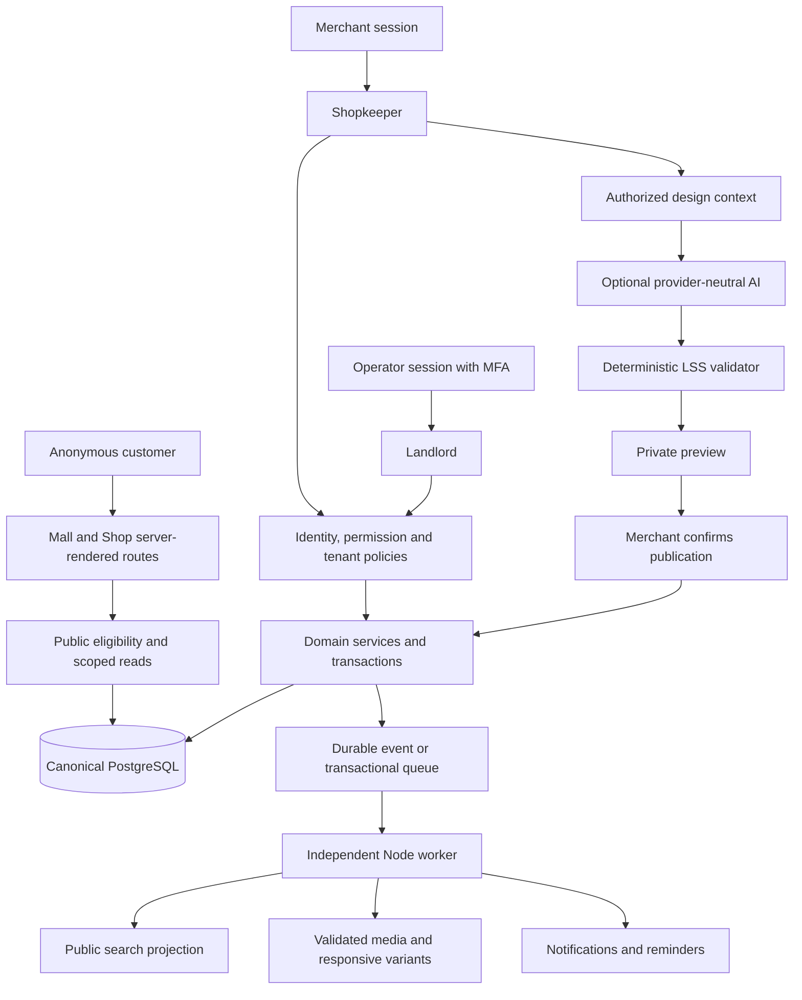
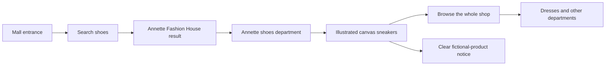
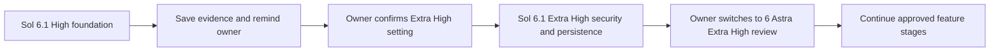

# Londos system and journey illustrations

These diagrams describe the intended application and the implemented preview separately. The SVG artwork under `public/illustrations` is platform-owned fictional demonstration art; it is not merchant-uploaded content or photography.

## Intended application boundaries

PostgreSQL, the security boundary, durable worker, LSS publication and AI are planned for the later model stages. Their appearance in the diagram does not claim they are implemented.

## Implemented anonymous preview journey

No account or AI call is needed for this path. Purchases and enquiries remain unavailable in the read-only preview.

## Model handoff sequence

The assistant records the next setting in BUILD-STATUS. The owner operates the model selector; the assistant does not switch it automatically.

## Local artwork inventory

- `mall.svg`: independent shops around a shared courtyard.
- `shop-*.svg`: six category-specific sample storefronts.
- `product-*.svg`: ten product/service illustrations, marked as samples.

The application renders these fixed trusted SVGs with explicit dimensions and lazy loading except for initial hero/product art. Arbitrary tenant SVG uploads are not enabled; their validation policy belongs to the media-security stage.

Validated screenshots and their exact stage/environment are recorded in [the High-stage evidence report](evidence/HIGH-STAGE.md).
