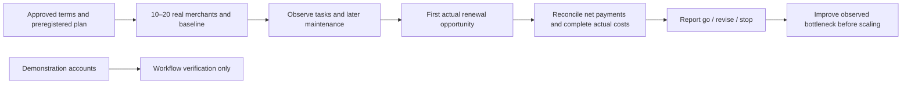

# P13 execution and decision tooling

The implemented tooling prepares a controlled experiment and produces a bounded, reviewable decision report. The owner authorized a fictional development cohort rather than supplying real participants. Twelve native demonstration accounts are prepared separately; they do not establish recruitment, consent, discovery value, customer purchases or paid renewal. The actual P13/G6 gate remains open until real evidence exists.

## Prepare before collecting outcomes

```bash
npm run pilot -- prepare .local/pilot-next
npm run pilot -- hash .local/pilot-next/plan.json
```

Preparation refuses existing output files, uses mode 600 and creates a proposed demonstration plan plus an empty data journal. Credentials and real identities belong in neither file nor Git. Pseudonymous participant codes (`P01`–`P20`) and shop UUIDs are sufficient; keep the separate roster/consent documents under approved access controls. For a real experiment, review the proposed terms and thresholds, set `evidenceKind=real`, record the live policy approval and independently witnessed/committed pre-outcome registration reference, then hash that exact plan **before observations**. Set the data journal's `planSha256` to that hash. A changed plan refuses the old dataset; do not lower thresholds after seeing results. Local timestamps/hashes alone do not prove independent preregistration or true facts.

The default proposal is **UGX 5,000 per 30 days with seven-day grace**, approved only for development. It is not a permanent price promise or approved live contract. The proposed 45-day observation window includes a full rent period and grace; it must accommodate each participant's actual opportunity, not merely the earliest member's calendar. Proposed numeric thresholds:

| Measure                                   | Go threshold | Denominator and meaning                                                                                                                                  |
| ----------------------------------------- | ------------ | -------------------------------------------------------------------------------------------------------------------------------------------------------- |
| Independent publication                   | ≥70%         | All recruited cohort merchants; no assistance during the publication task.                                                                               |
| Later maintenance                         | ≥60%         | All cohort merchants; observed catalogue maintenance at least seven days after publication.                                                              |
| Fully paid first renewal                  | ≥60%         | First completed actual renewal opportunity per merchant, after its due date plus grace; ≥10 complete opportunities and coverage for every cohort member. |
| Merchant-confirmed incremental value      | ≥50%         | All cohort merchants; documented follow-up interview, separate from aggregate route counts and intent.                                                   |
| Median reported assistance + verification | ≤60 minutes  | All cohort merchants over explicitly observed tasks; queue age is excluded.                                                                              |
| Variable contribution                     | ≥UGX 0       | Reconciled net real payments minus complete actual operating costs, before separately reported acquisition.                                              |
| Unresolved critical trust incidents       | 0            | Any such incident stops continuation.                                                                                                                    |

At most 20 participants are accepted. With complete evidence, ≤20% first paid renewal yields `stop`; missing a go threshold otherwise yields `revise`. Missing registration, live terms, participant/observation/follow-up/renewal/cost/traffic/recommendation coverage yields `insufficient-evidence`. A critical unresolved trust incident yields `stop` even when other evidence is incomplete. Negative contribution cannot receive `go`; acquisition scaling also requires nonnegative net after acquisition. A later successful renewal cannot erase an earlier failed first opportunity.

## Record actual observations

The closed input schema is [contract.ts](../src/modules/pilot/contract.ts). Each participant has pre-onboarding discovery channels, digital presence, catalogue size, contact methods, pain category, willingness-to-pay expectation and monthly digital spend (`null` when unknown). Record every attempted application/setup/catalogue/design/contact/publication/sharing/maintenance task as independent, assisted, operator-completed or failed, with actual assistance and verification minutes and a private evidence reference. Independent completion permits separately measured verification work but no task assistance. Record maintenance later, follow-up incremental value, renewal intention and the observed bottleneck. Do not do every task for a merchant and call it self-service activation.

Ledger input carries distinct invoice IDs, initial/renewal kind, independently established due dates/coverage dates, amount/currency, **net** payment and waiver amounts after linked reversals, reconciliation status and evidence kind/reference. Verify immutable canonical rent events and any actual collection receipt. A development invoice or polite willingness-to-pay response is not a real payment. Waiver-supported coverage remains separate from fully paid renewal. Do not infer a due date from a mutable finalized coverage start or substitute an issued invoice count for an actual opportunity. Native operator analytics provides canonical aggregate renewal indicators; it does not independently verify bank cash or supply the complete first-opportunity research ledger.

All seven cost categories are mandatory: collection fees; support/verification; moderation; storage/bandwidth; compute/search/media; AI; acquisition. Record actual UGX minor units, evidence, an allocation reference and completeness. Estimates, missing bills, incomplete staff coverage and an empty journal remain unavailable rather than zero/free. A known actual zero still needs evidence and allocation. Staff-minute valuation requires a reviewed actual cost/allocation method; no hourly rate or USD-to-UGX conversion is invented. Acquisition is separated from operating contribution and then included in net economics.

Provide privacy-filtered **cohort-shop** route counts with retained-window coverage: direct/discovery/unattributed shop, department, product, contact-action and result-click events, plus separate canonical publication/catalogue activity. The application's minimal analytics has no unique visitor identity, cross-page linkage or completed-sale events. Ratios cannot be described as linked funnels, repeat customers or causal discovery. Record repeat engagement and cross-department journeys through consented observation/interview evidence where appropriate; no tracking identifier is added here. A retention window shorter than the experiment cannot be silently presented as complete.

Track trust incidents with pseudonymous subject, severity, resolution and evidence reference. Record measured architecture bottlenecks and a justified proposed change. Include product-change and pricing recommendations, even if the recommendation is to keep the current approach and observe another cohort.

## Generate and review the decision

```bash
npm run pilot -- report .local/pilot-next/plan.json .local/pilot-next/data.json .local/pilot-next/report.json
```

Exit 0 means a report was generated with `go`, `revise` or `stop`; it does **not** mean the decision was go. Exit 2 produces an honest `insufficient-evidence` report. Exit 1 means invalid input or an existing output file, which is never overwritten. Inspect the report's decision, blockers, denominators, criteria, costs and limitations. A small-cohort descriptive Wilson interval accompanies renewal; it is not population inference or causal proof. Strict parsing rejects duplicate merchants/shops/invoices/cost categories/count buckets, cross-subject ledger incidents, unknown fields, overcredit, future/out-of-window observations and changed plan hashes. Monetary sums use integer `BigInt`, never floating point.

The report contains the required funnel, cohort maintenance/renewal, exact net economics, assistance, separate discovery observations/interviews, trust incidents, architecture bottlenecks, product changes and pricing recommendation. Human reviewers must inspect evidence references, consent, actual payment/cost sources and preregistration. Supplied values are not automatically authenticated facts. Keep real journals/reports private; publish only approved aggregates. The checked-in [initial report](evidence/P13-INITIAL-REPORT.json) deliberately has no real participants or outcomes and cannot support a business decision.



## Containment and next actions

Keep live collection off under the existing development policy. Complete G5 before a public pilot. Recruit real merchants only after policies, consent, roles, launch and service capability review. During the experiment stop for critical security/trust/privacy/financial defects. Improve the bottleneck supported by observations; do not invent outcomes to select product work. For measured infrastructure pressure, start with indexes/bounded queries, then queue/cache/capacity tuning; dedicated search, read replicas and partitioning need evidence. Preserve public shop UUID/slug identity and immutable financial history.

P13.1–4 and G6 require real-world recruitment/observations/one renewal period; they are not completed by seeding. P13.5 has implemented numeric proposal/validation/report tooling but still needs approved preregistration and actual evidence. P13.6–7 remain conditional on those findings. See [the experiment](PILOT-EXPERIMENT.md), [G5/P13 evidence](evidence/G5-P13.md) and [deployment profiles](DEPLOYMENT-PROFILES.md).
