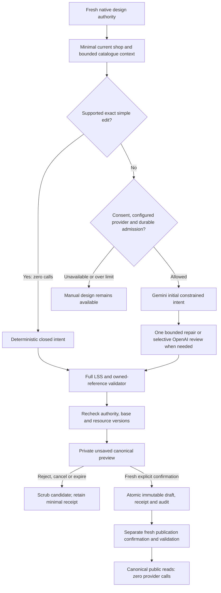

# Shop Design Pipeline

P10's implemented local workflow turns merchant language into safe, reversible design proposals. Read [ADR-0013](ADR/0013-provider-neutral-conversational-design.md), [LSS](SHOP-SPECIFICATION.md), [contracts](CONTRACTS.md) and [gate evidence](evidence/X2-P10.md). Both live providers are currently unavailable; local/fake contracts do not establish model quality or live access.



## 1. Scope current context

Check current shop design membership/shop grant and native authentication freshness before context assembly. Owners use existing ownership; staff need both design membership and shop grant. Support/cost/operator grants do not substitute. Enrolled MFA needs its current verified proof; otherwise the native five-minute sign-in rule applies.

Load only current validated LSS, public name/category/tagline and bounded active owned department/product IDs, labels and versions. The first 30 departments/32 products plus all existing referenced resources are bounded by 32,000 context bytes and existing LSS limits. Exclude descriptions, contacts, identities, private evidence, keys and unrelated shops. Merchant/catalogue text is untrusted JSON data. No model tools, filesystem/database access or executable output exist.

## 2. Interpret a closed intent

Supported exact theme/action/uniquely named department moves use no provider, even with requested quality review. Examples: `Use plum theme`, `Remove the call button`, `Keep WhatsApp visible`, `Move Shoes before Handbags` when both labels uniquely identify saved department spaces. Ambiguous/combined redesign needs external consent, configured credentials/model/approved rates and durable request/token/configured-estimate/concurrency admission.

Actual structured output has a closed contract, for example:

```json
{
  "patches": [{"op": "theme", "theme": "plum"}],
  "confidence": "high",
  "review": "not_needed"
}
```

At most eight patches allow existing theme/actions/move, announcement and bounded add/replace/remove of existing safe spaces. Unknown fields/operations fail validation. Gemini is initial when configured; OpenAI review is selective for quality, low confidence, recommended review or successful bounded repair. Explicit outage fallback is optional; quota/cooldown never cycles providers/keys. One repair/transient retry and at most three attempts apply, with eight-second provider/30-second overall deadlines.

## 3. Compile and validate

Treat every provider/reviewer intent as untrusted. Compile through complete existing LSS schema, byte/space/card/identity/action limits and canonical owned-reference validation. Review cannot widen the contract. Reject script-like generated text; other SQL/JS strings remain literal escaped text with no execution path. Recheck current authority/base design/bounded context/resource versions after network or lock waits and before storing/applying. Changed or archived resources and newer drafts produce a conflict, never an overwrite.

## 4. Preview an unsaved candidate

The original requester alone can read a proposal under current fresh design access. The canonical renderer presents a private unsaved candidate; no draft/publication/provider/analytics effect occurs. The merchant may reject, request a new refinement against current state, or manually adjust a saved draft. Low-confidence/changed/unavailable review is explicit and requires acknowledgment when a candidate is offered.

Candidates expire after 15 minutes. Applying/rejecting/cancelling/expiring scrubs candidate/patches. Immediate expiry is enforced even when maintenance stops; existing lease-fenced maintenance cleans bounded expired/dead-lease rows. Cancellation fences later calls/candidate effects without a refund promise.

## 5. Confirm application as a draft

Original requester/current fresh design access, exact proposal version, unchanged base/context/references, explicit confirmation and required review-warning acknowledgment guard application. Revalidate and atomically create an immutable new draft, scrubbed terminal result and minimal audit. SQL failure rolls all effects back. Stable original-actor retry keys/decision identities repeat the original outcome without duplicate calls/revisions; changed bodies conflict.

## 6. Publish separately

Use the existing independent fresh publication command with current publish permission, matching draft/revision and explicit confirmation. It revalidates full LSS/references and current tenancy/publication/moderation eligibility before moving the canonical published pointer. AI has no publication command. Public reads are no-store and contain no provider path; no shared public cache invalidation is claimed.

## Failure, retention and usage

Provider absence/outage/quota/budget/conflict preserves templates, manual editing, saved drafts and existing published shops. Main remote processing defaults off. Credentials use actual secure server bindings and fixed HTTPS provider destinations with normal proxy/CA/TLS; the managed OpenAI binding is `LONDOS_OPENAI_API_KEY` because the platform reserves the standard name.

No raw natural-language instruction/prompt/invalid response/provider error body is persisted. Minimal immutable retry/attempt receipts contain redacted provider/model/fixture-or-live-transport/purpose/outcome/latency/reported-token/configured-estimate metadata. Configured USD estimates, durable conservative reservations and provider-reported tokens are not actual bills or merchant charges; missing usage stays unmeasured. Production metadata retention/legal terms/physical backups and live account/model-quality/rate verification remain release obligations.
