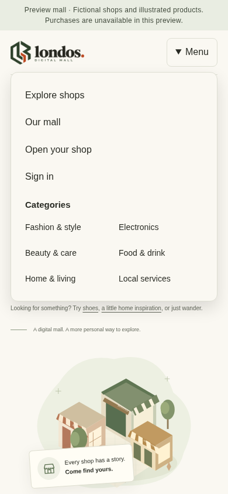

# Audit follow-up verification — 21 October 2026

Branch: `feature/communications-billing-2026-10-10`.
Source baseline: `c9e0361e3786b364b7566d527448d63ad9094c6b`; initially clean.
Scope and decisions: [audit response](../AUDIT-RESPONSE-2026-10-21.md).

## Checks actually executed

| Command/check | Result |
| --- | --- |
| Existing `p13` and search-indexing unit suites | 51 passed |
| `npm test -- tests/unit/audit-followup.test.ts tests/unit/p13.test.ts` | 43 passed |
| `npm run typecheck` | Passed |
| `npm run build` | Passed, including final hosted-footer correction; compiled web and worker |
| `npm run lint` | Passed, including final changes |
| `npm run test:integration -- tests/integration/hosted-shops.test.ts tests/integration/p6.test.ts tests/integration/p8.test.ts tests/integration/p9.test.ts` | 68 passed |
| Hosted shop integration rerun after final footer correction | 4 passed; these overlap the preceding 68, not four additional unique cases |
| `PLAYWRIGHT_CHROMIUM_EXECUTABLE_PATH=/usr/bin/chromium npm run test:e2e -- tests/e2e/audit-mobile.spec.ts tests/e2e/public-preview.spec.ts` | 22 passed across desktop/mobile projects |
| `PLAYWRIGHT_CHROMIUM_EXECUTABLE_PATH=/usr/bin/chromium npm run test:e2e:core -- audit.spec.ts` | 4 passed across desktop/mobile projects |
| `npm run check:bundle-secrets` | Passed: 1,778 artifact files, 37 configured candidate values; values not printed |
| `npm run check:docs` | Passed |
| `git diff --check` | Passed |

The final selected functional set covers 43 unit, 68 integration and 26 browser
cases; repeated checks are not added to those totals. Unit tests additionally
exercise disabled/missing contact choices, private-preview enquiry exclusion,
external/traversal CTA rejection, incomplete button fields, partial and pending
invoice states, large integer balances and missing/invalid grace dates.

Browser checks cover menu navigation at 320/390/430px, 44px menu-link targets,
Escape/focus return, category navigation, no horizontal overflow and automated
axe checks. Merchant tests use actual sign-in, the real setup query, the mobile
merchant link and a foreign-shop denial. Receipt tests submit a real fictional
report to the disposable database, download its reference, verify the stored
report ID, and confirm that private upload access and report text are absent
from the downloaded receipt.

Existing integration suites exercise publication, design validation, rent
reconciliation, report idempotency/attachments, trust boundaries, hosted secure
origin handling, merchant navigation and indexing. The final hosted check proves
the shop footer no longer falsely labels hosted shops as development fixtures and
does not link to the guarded local report form.

All databases used for integration/browser mutations were disposable, guarded
test databases. No real account/email/payment/provider was exercised. No P12
recovery or production drills were repeated. Browser emulation is not a physical
Android test; automated axe checks do not prove full accessibility conformance.
The secret scan checks configured exact values, not every possible unknown secret.

## Visual check

The fictional preview was launched locally and the 390px menu was inspected.
The image below shows the menu, not a report/customer record.

## File inventory

- Added `src/components/mobile-navigation.tsx` and updated
  `src/components/site-chrome.tsx`, `src/app/globals.css`.
- Added `src/modules/shop-design/contact-actions.ts`; updated
  `src/components/canonical-shop.tsx` for priority, enabled actions and mode-aware
  disclosures/reporting availability.
- Updated `src/components/trust-controls.tsx` for reference display and download.
- Added `src/modules/rent-presentation.ts`; updated `src/server/rent.ts`,
  `src/components/lifecycle-controls.tsx` and
  `src/app/shopkeeper/shops/[shopId]/rent/page.tsx`.
- Updated `src/server/workspace.ts` and
  `src/app/shopkeeper/shops/[shopId]/page.tsx` for advisory setup guidance.
- Added `src/modules/communications/cta.ts`; updated
  `src/server/communications.ts` and `src/components/communications-controls.tsx`.
- Added `tests/unit/audit-followup.test.ts`, `tests/e2e/audit-mobile.spec.ts` and
  `tests/e2e-core/audit.spec.ts`; updated `playwright.core.config.ts` and
  `tests/integration/hosted-shops.test.ts`.
- Added the audit response, this evidence file and the mobile-menu screenshot;
  updated `README.md` with the audit-response link.
