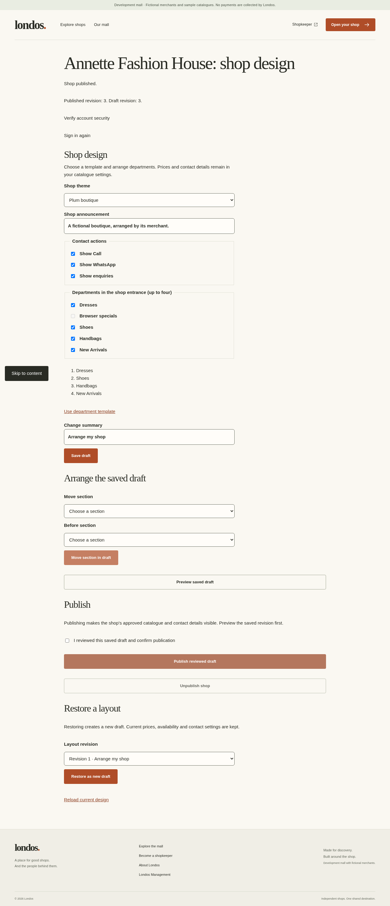
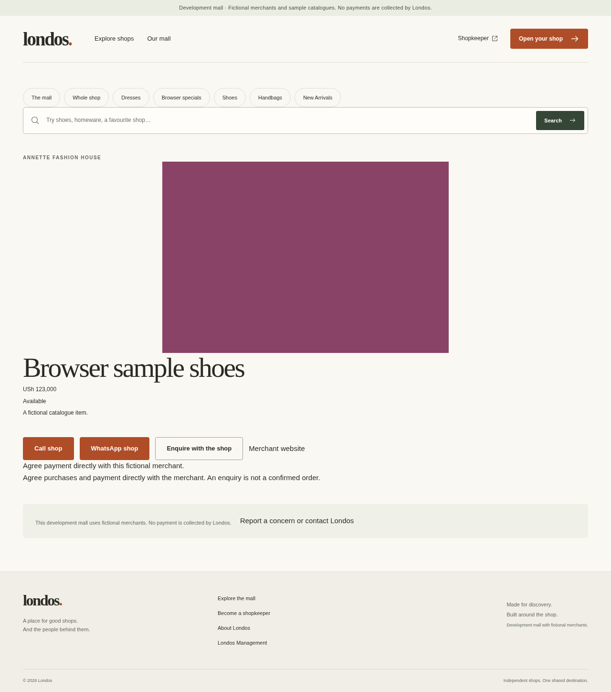
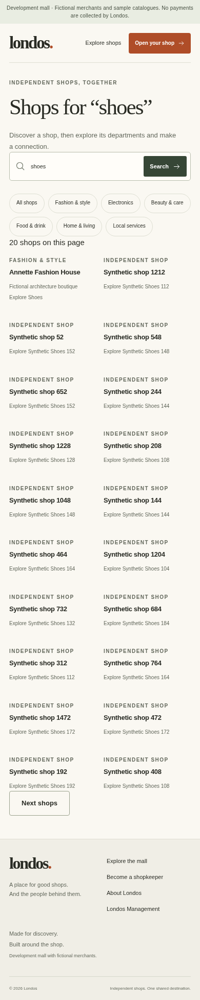

# X2 P6–P7: safe publication and canonical public discovery

Verified 2026-10-05. The owner confirmed **Sol 6.1 Extra High**, authorized a new implementation branch and instructed “Continue X2.” The assistant records that workflow; it cannot inspect/change the model selector. This closes the **local P5–P7 architecture prototype**, including G2's six-slice experiment within the limits below. Full-build, live-provider and production gates remain open. P8 continues at the same setting.

Branch: `codex/londos-x2-2026-10-05`. H, X1 and R1 were preserved unchanged; P5 is the separately pushed `c19a26a` packet. This extends [P5 evidence](X2-P5.md), [ADR-0005](../ADR/0005-safe-design-and-canonical-public-reads.md), [the plan](../IMPLEMENTATION-PLAN.md) and [build status](../BUILD-STATUS.md).

## Implemented behavior

- **Strict LSS/manual design:** integer schema version 1; fixed earth/plum/blue themes; versioned department shelves, explicit product shelves, plain-text stories and contacts. Eight unique spaces, 32 cards, eight cards per source, three actions and 7,000 specification bytes bound complexity. Unknown properties/versions, script/HTML/CSS/URL properties, trusted badges and unrestricted SEO/extensions fail validation. Markup within text renders as escaped plain text. Current owned/unarchived references are checked on save, publish and restore.
- **Private drafts/immutable revisions:** separate current design/publish grants, authorization recheck after the merchant lock and base-version conflicts. Draft saves, bounded deterministic patches and private preview never auto-publish. Publication requires explicit confirmation, a matching saved revision, recent native authentication and current eligibility. Restore appends an audited draft; current prices/contacts/stock/financial state are not copied into layout history. Unsupported stored legacy layouts have a safe platform fallback; invalid new writes fail.
- **Canonical public rendering:** configured local `database` mode uses bounded repeatable-read PostgreSQL reads; fixture mode remains supported. Active publication, active/due/grace tenancy and clear moderation are required, with a published design pointer for shops/discovery/images. Due/grace never overrides moderation. UUID links redirect to current safe slugs after eligibility checks. Missing/archived references are omitted or show a useful shop fallback. Batched resolution avoids per-card SQL; product position controls shelf ordering. Platform navigation/status/report disclosures cannot be removed by merchant LSS.
- **Ready images:** public thumbnail/card/display reads recheck current eligibility, ready state and attachment to an unarchived owned product/department. Quarantine and normalized rebuild-source have no public download. Platform images use processed variants, dimensions, alt text, aspect ratios, responsive selection and lazy loading. A subsequent request after unpublish/suspension is denied.
- **Shop-first discovery:** generated English vectors and partial GIN indexes behind `SearchService`; eligibility before best-match aggregation; one result per shop; no rent/internal mall ranking signal. Parameterized queries support global/category/shop-local scopes, deterministic ties, validated scope-bound cursors and 20-row pages. Limits: 80 characters/eight words and a two-second SQL deadline. Empty-query browsing includes new eligible publications; canonical updates are visible without internal profile-projection jobs.
- **Freshness:** dynamic/no-store routes, disabled public prefetch and request-local memoization; no shared response/CDN cache. Generated vectors change in the canonical transaction. ADR-0005 records replacing the initial asynchronous public projection proposal with canonical indexed reads. Already delivered browser content cannot be retroactively erased; remote CDN/BFCache revocation is unverified.

## Verification

**130 passing tests:** 22 unit, 81 real PostgreSQL integration, 16 fixture public browser and 11 core production-browser tests. Existing identity/MFA, ownership, tenant isolation, outbox/crash and P5 media tests remain passing. New coverage includes hostile specification props/budgets; actual native sessions and staff grants; foreign references; stale publication conflicts; fresh authentication; restore preserving current prices; legacy fallback; position ordering; due/grace versus closed/provisioning/suspended states; public media/unpublish denial; live search updates, stale internal projections, cursors and a real two-second contention timeout.

All six new protected design methods join P5's 15-method HTTP attack registry for anonymous and foreign-tenant requests. Production browsers cover save/patch/private preview/explicit publish/restore, metadata/deep links/images, no-JavaScript public HTML and unpublish denial. Desktop/mobile forms have explicit labels and mobile accessibility/keyboard checks passed. This is local regression evidence, not a complete assistive-technology or production security certification.

Lint, strict types, documentation links, formatting, standalone web/independent worker builds passed. Full dependency audit: **0 vulnerabilities**. Configured-secret artifact scan: **657 files / 8 candidate values**, with no values printed; exact current values only, not universal secret scanning. P6/P7 adds no dependency/lockfile change. The P5 test-output credential incident/remediation remains in its historical report; subsequent suites and benchmark completed without that teardown failure.

## Existing database upgrade

[008→009 evidence](X2-P6-MIGRATION.json): **1,407 ms**, preserving existing canonical fields and application credentials; repeated migration/seed preserved existing records. Checkpoint counts: 1,506 shops, 150,004 products, 1,504 departments; no media/revisions/contacts/requests/invoices/rent events. New category/tagline/generated vectors were excluded from comparisons of old fields. Migration 009 adds immutable tenant-consistent revisions/pointers and indexed public reads; its new-write size check preserves legacy rows. Applied migrations remain immutable.

The checkpoint predates preparation of the fictional Annette design in the current local runtime. This proves logical local preservation, not production backup restoration, zero downtime or remote rollback safety.

## Architecture experiment

After a production build, run from the repository root:

```bash
npm run benchmark:x2
```

The [script](../../scripts/benchmark-x2.ts) creates a guarded random local test database, migrates/seeds fictional native accounts, generates deterministic `londos-x2-v1` data and adds marked collection/design fixtures only there. It launches compiled web/worker, uses actual native sign-in, exercises all six slices and records real plans/resources. Cleanup removes only its own processes/database; it never rewrites or mass-publishes the main development dataset.

Final dataset: **1,506 shops, 150,004 products, 9,004 departments, 1,501 design records**. Linux 6.18.44, Node 24.19.0, four available CPUs; cgroup CPU `400000 100000`, memory 32 GiB. The benchmark hierarchy deliberately differs from the preserved main database's 1,504 departments. No other test suite ran during measurement.

Budgets were declared before measurement in ADR-0005. [Final benchmark](X2-BENCHMARK.json), 2026-10-05T06:33:04.215Z, supersedes earlier runs after correcting the resource sampler to include the standalone web child.

| Measurement | Final observation | Declared limit |
|---|---:|---:|
| Search service, 20 samples | p50 80.79 ms; p95 89.54 ms | p95 ≤250 ms |
| Shop service, 20 samples | p50 7.97 ms; p95 13.39 ms | Recorded |
| Warm SSR/body, 10 samples per route | Highest p95 101.74 ms, search | p95 ≤500 ms |
| 20-client/200-request read burst | p95 524.40 ms; max 648.85 ms; **0 errors** | p95 ≤1,500 ms; 0 errors |
| Estimated gzip HTML | Maximum 5,527 bytes | ≤80 KiB |
| Initial encoded JavaScript, 390×844 Chromium | Maximum 142,107 bytes | ≤200 KiB |
| Initial encoded images | 326 bytes, synthetic product | ≤350 KiB |
| 6,000×2,000 image upload acknowledgment | 9.62 ms | ≤1,000 ms |
| Durable worker ready | 259.17 ms | ≤5,000 ms |
| Canonical price write/subsequent read | 17.54 ms | Recorded |

The five-route read burst completed in 2,201.61 ms (observed 90.84 requests/second for that short run). Merchant writes and worker processing were tested separately. This is **not sustained mixed-write load, saturation/capacity or a production throughput promise**. Warm loopback timings omit mobile-network latency. The compressible solid-color image proves bounded processing, not photographic quality or realistic image costs.

Service instrumentation counted four SQL commands/one SELECT per search and seven commands/four SELECTs per shop, including transaction control; these are not full SSR query counts. [Actual EXPLAIN ANALYZE/BUFFERS](X2-SEARCH-PLAN.json) used indexed shop/department paths and a sequential product scan for the broad synthetic “shoes” term. No forced-index or universal GIN-use claim is made; selective/live workloads remain P11 measurement.

Web process-tree RSS before/after burst: 210,571,264→322,920,448 bytes; worker: 108,822,528→109,346,816 bytes. Process CPU delta: 1.84 seconds. These are observations, not peak memory; CPU excludes PostgreSQL/browser and is not whole-host utilization. Worker pending count was zero at sampling, with no oldest pending job. Upload acknowledgment and worker-ready latency are separate.

All six slices passed: validated rendering, bounded discovery/deep link, canonical update, foreign-tenant denial, asynchronous media and version-checked manual patch. G2's local experiment is accepted within the measured scope.

## Visual and runtime evidence







Screenshots contain fictional development data and no authentication secrets. [Local runtime evidence](X2-LOCAL-RUNTIME.json) records matching main web/worker after migration 009, database/authentication readiness, separate worker heartbeat, canonical Annette public content and no-store responses. Live notifications and financial operations remain false. Fixture mode passed separately in its isolated browser suite.

## Remaining work and next model

Continue **P8 at Sol 6.1 Extra High**; no new setting confirmation is needed. P8–P12 remain open: applications/operator workflows, rent/provisioning/reconciliation, reporting/moderation, analytics, provider-neutral AI, approved policies, live delivery/object storage/CDN, production roles, sustained load, backup restoration and release review. R2 later uses **6 Astra Extra High**, with an earlier handoff only for a concrete unresolved critical decision.

The wider LSS registry and public catalogue pagination remain full-build obligations. Current department pages initially return 20 products, entrance shelves at most 32 cards and department navigation is bounded. English stemming/basic one-per-shop grouping/new-shop browsing do not establish typo/multilingual relevance or live spam operations. Report UI discloses unavailable live support/report delivery; no complete reporting service or merchant-controlled trust badge is claimed. Remote ingress/provider/CDN behavior, photographic quality, production recovery and fresh-task cloud restoration need separate evidence.

Reusable instructions/configuration are saved as a cloud draft. Draft persistence does not activate/publish it: the owner reviews/saves settings and publishes through the product. Git push establishes the remote branch, not deployment or GitHub Actions execution.
